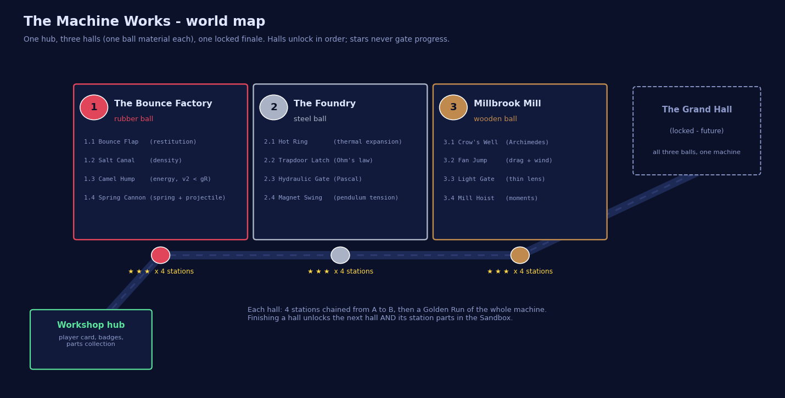
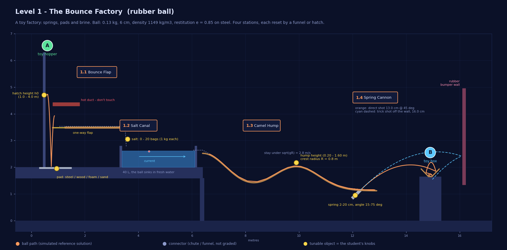
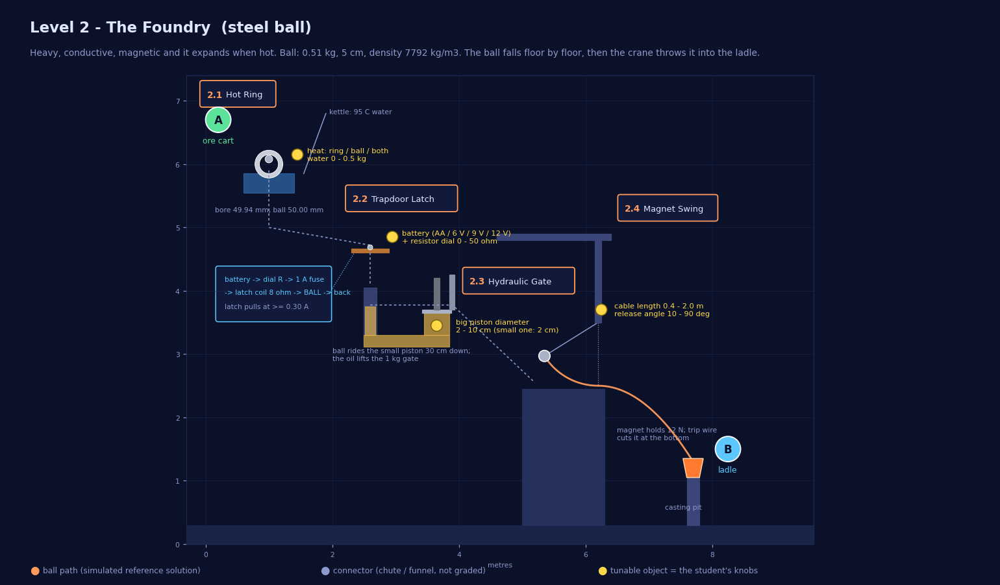
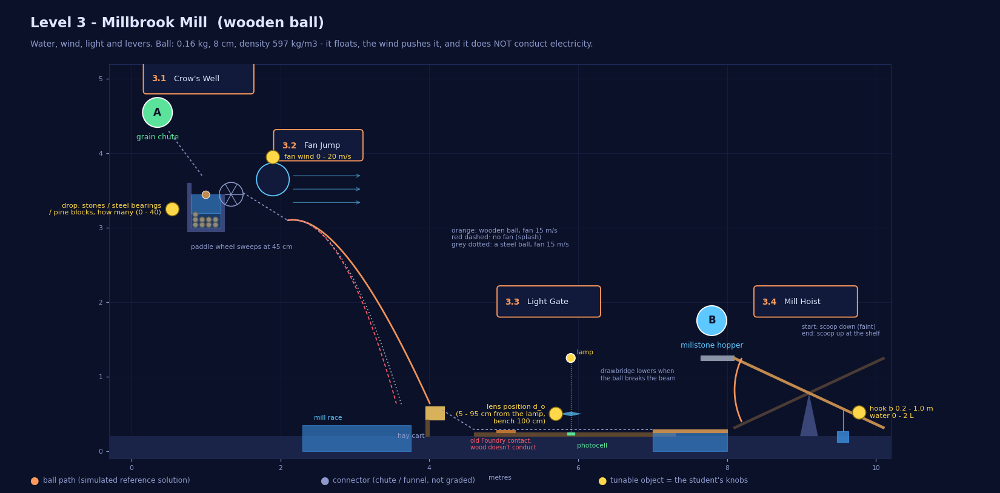
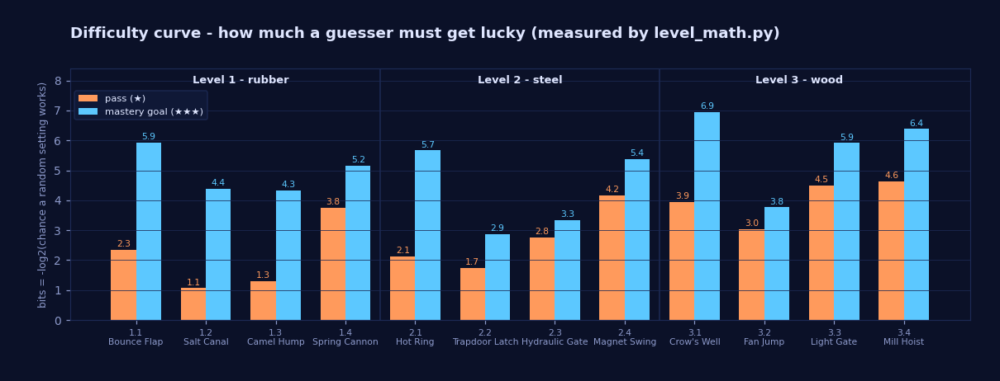

# The Machine Works — Game Design Document

**Game 1 of the physlab Game module: a Rube Goldberg machine, three halls, three ball materials**

| | |
|---|---|
| Status | Design v1.0. **All three halls are implemented** (the Bounce Factory, the Foundry, Millbrook Mill): see [`IMPLEMENTATION-hall1.md`](IMPLEMENTATION-hall1.md), [`IMPLEMENTATION-hall2.md`](IMPLEMENTATION-hall2.md) and [`IMPLEMENTATION-hall3.md`](IMPLEMENTATION-hall3.md) |
| Audience | physlab team: engineering, physics content, art, teachers |
| Players | 10–15 year olds, in class or at home, offline |
| Companion files | `level_math.py` is the design calculator. It verifies every number in this document with the real physlab engines. `level_math_results.json` holds its output. `make_diagrams.py` draws the figures in `img/`. |
| Reproduce | `python3 docs/game/level_math.py` (about 4 min) then `python3 docs/game/make_diagrams.py` |

---

## 0. One-page summary

**Pitch.** *The Machine Works* is a Rube Goldberg factory. In each hall one ball has to travel from
**A** to **B** through a chain of contraptions. The student can't touch the ball. They tune the
**machine** instead: how high the hatch is, how much salt goes in the canal, how hard the spring is
compressed, which battery powers the latch, where the lens sits. Then they press **Run**. The
contraptions are physlab's own simulations, so the ball does exactly what physics says. If a setting
is wrong, the ball visibly fails, and the game says why, with the real formula and the real numbers.

**The hook for the three levels.** Every hall is built around **what its ball is made of**:

| Hall | Ball (from the sandbox box) | What the material lets it do | Stations |
|---|---|---|---|
| 1. The Bounce Factory | Rubber ball: 0.13 kg, 6 cm, 1149 kg/m³ | bounces (e = 0.85), just sinks in water, light enough to fire from a spring | Bounce Flap · Salt Canal · Camel Hump · Spring Cannon |
| 2. The Foundry | Steel ball: 0.51 kg, 5 cm, 7792 kg/m³ | conducts, is magnetic, is heavy, expands when hot | Hot Ring · Trapdoor Latch · Hydraulic Gate · Magnet Swing |
| 3. Millbrook Mill | Wooden ball: 0.16 kg, 8 cm, 597 kg/m³ | floats, gets pushed by the wind, does **not** conduct | Crow's Well · Fan Jump · Light Gate · Mill Hoist |

**Core loop.** Observe → tune the knobs → (predict) → run → debrief → retune. Each station has
three independent stars: ★ *It works*, ★ *Efficient* (within par), ★ *Mastery* (a
station-specific engineering goal that needs the formula, e.g. "just enough salt").

**Why it teaches.** The reward rules are designed (section 8) so that a student's best strategy is
to reason it out: estimate with the formula, run, read the feedback, correct. Guessing and
slider-sweeping *work*, so nobody gets stuck, but they cost stars. Each student gets slightly
different numbers, so copying a friend's settings doesn't work. Copying their *method* does.

**Backward design.** 12 stations were designed first. Then we checked which physics physlab
already has. **10 of the 12 are built on an existing engine** (energy, buoyancy, heat, circuit lab,
pressure, pendulum, optics, projectile), each needing a small extension. The other 2 need new lab
topics: **Bounces & Collisions** (Level 1) and **Levers & Moments** (Level 3). Section 9 lists
the work, and each hall ships after its physics has landed in the Simulations module.

**Everything here has been checked.** For every station, `level_math.py` confirms:

- the reference answers pass;
- the common wrong answers fail;
- every per-student variant is solvable;
- how guessable the puzzle is, measured in bits.

The level-map trajectories are simulated, not drawn by hand.

---

## 1. Vision, pillars and goals

### 1.1 Design pillars

1. **Physics is the controller.** The student never pushes the ball. They set parameters on
   objects, and the real engine decides what happens. The same validated parameters always give
   the same frames (physlab design rule 2), so every result can be reproduced and explained.
2. **The material is the level.** Each hall's ball is the key to that hall. Every station has a
   *material hook*: a reason it works with *this* ball. "Material ghosts" (4.5) show the other
   balls failing in the same setup.
3. **Every failure teaches.** A failed run is never just "wrong". The ball visibly does something:
   splash, clang, flung, stalls. Then the debrief says what happened, what was measured, what was
   needed, and which way to go, like the quiz's low/high feedback.
4. **Reasoning beats guessing.** Unlimited retries, never a dead end. But stars and points reward
   the behaviour we want: predict, calculate, verify. This is designed, not hoped for (section 8).
5. **Built from the lab.** Same engines, same catalogs (balls, batteries, liquids, friction),
   same UI components (Stage, Player, sliders, handles, learn panel), same strict validation, same
   offline stdlib stack. The game *tests* what the lab *teaches*, and every station links back to
   the lab experiment with the same numbers.

### 1.2 Learning goals

| Hall | After the hall, a student can… |
|---|---|
| 1 | use `h₁ = e²·h₀` for a bounce; explain floating as density (`ρ_liquid > ρ_ball`); use `v ≤ √(g·R)` over a crest together with energy conservation; chain spring energy `½kx²` into the projectile equation |
| 2 | predict thermal expansion `ΔD = α·D·ΔT` and see why heating the *wrong* part makes things worse; use Ohm's law with internal resistance to hit a current *window*; use Pascal's trade-off `F₁d₁ = F₂d₂` under two limits; use string tension `m(g cosθ + v²/L)` as a design limit |
| 3 | use Archimedes' displacement, including why floaters displace only their weight; estimate a drag push `F = ½ρC_dA(w−v)²`; use the thin-lens and magnification equations and see why one of two "sharp" positions fails; use the principle of moments `M·b > m·a`, then add "just a little more" |

These map onto the usual lower-secondary (KS3/KS4, grades 6–9) topics: forces and motion, energy
stores, density and pressure, electricity, thermal physics, light.

### 1.3 Non-goals (v1)

- Free-form machine building. The halls are authored. A builder is the long-term reward (§3.5).
- Real-time reflex challenges or timers against the player. Time only appears as *physics*
  (e.g. "arrive in 2.12 s").
- Accounts, online services, purchases, ads. Same rules as the rest of physlab.
- Photoreal art. Flat vector look, matching the app.

### 1.4 Session shape

One hall takes **15–25 minutes** for a first clear, which fits in a lesson. Mastery replays are
for homework or fast finishers. A station's first attempt should take 2–5 minutes.

---

## 2. How the game fits physlab

```
   LAB (Experiments)  ──teaches──►  SANDBOX  ──explores──►  CHALLENGES (quiz)  ──applies──►  GAME (Machine Works)
   one formula, live              real objects,             "set X so that Y",               a chain of Ys, a story,
   numbers, learn panel           fixed properties          graded by the sim                stars, unlocks
        ▲                                                                                         │
        └───────────────────── "Open in the lab" deep link from every station debrief ◄──────────┘
```

**What the game reuses (no rewrite):**

| physlab piece | Used by the game for |
|---|---|
| `physlab/topics/*.py` solvers | the physics of 9 stations (table in §9.1) |
| `physlab/sandbox.py` catalogs: `BOBS`, `FRICTION`, `PARTS`, `LIQUIDS`, `SOURCES` | the three balls, rolling resistance, batteries, liquids (real published values) |
| `sandbox.validate()` field kinds (`number`, `choice`, `object`) | knob specs and server-side validation of every run |
| `quiz.py` grading philosophy | grade by **running the simulation**, never against a stored number; low/high feedback; reveal after 2 failures |
| `quizdb.py` (SQLite, nickname players, score derived from rows) | progress, runs, stars, hints (new tables, same DB, same player) |
| `PL.Stage` (world camera, zoom, **draggable handles**), `PL.Player` (sim-time playback), `PlayBar`, `ControlPanel`, `learnPanel`, `widgets.js` | the whole level page (§10.6) |
| Deep links (`#/topic?...`, `#/sandbox/topic?w=...`) | "Open in the lab" from each station; shareable replays |

**Design rules carried over from the README, unchanged:** the engine lives in Python; same
parameters give byte-identical frames; every input is validated at the API edge; stdlib only, no
build step, offline.

---

## 3. World design: The Machine Works



### 3.1 Setting and story

The Machine Works is a huge old factory that builds the **Great Sorter**, a machine that sorts
anything by what it's made of. One morning the Sorter jams. To reboot it, the Works needs a test
ball of each material delivered to the Sorter's intake. Each intake sits at the end of a hall
built long ago for that material.

**Gizmo**, the Works' small robot foreman, hands the student a clipboard. Gizmo is the only
recurring character: it opens each hall, voices hints, and reacts to runs. Some sample lines:

- "Rubber! Bouncy, springy, a bit heavier than water. Remember that last bit."
- *(after a splash)* "It sank. Rubber is 1149 kg per cubic metre and fresh water is only 998.
  Something has to make the water heavier…"

Each delivered ball lights one of three lamps on the Sorter. Three lamps open the **Grand Hall**,
the hook for the next game (3.5). The tone is curious and funny, never punishing: failures are
slapstick (SPLASH, CLANG, boing-boing-boing), and the debrief is calm and exact.

### 3.2 The hub: the Workshop

The starting screen and the place between halls. It shows:

- **Player card:** nickname (the same player as the quiz), total stars (out of 36), points, badges.
- **Hall doors.** Doors light up when unlocked and show their stars.
- **Parts shelf:** the station parts unlocked for the Sandbox (§7.6).
- **Ball rack:** the balls collected so far. Each one unlocks its "material ghost" (§4.5).

### 3.3 Hall identities

| | Bounce Factory | Foundry | Millbrook Mill |
|---|---|---|---|
| Ball | rubber `#e0455a` | steel `#c0c8d8` | wood `#a8703a` |
| Palette accent | coral + teal, toy colours | amber glow + gunmetal | moss green + water blue + timber |
| Set dressing | conveyor belts, springs, toy crates, a brine tank | ore carts, a furnace glow, copper bus bars, oil cylinders, a crane | a cistern, paddle wheel, winnowing fan, mill race, drawbridge, lever hoist |
| Physics theme | elasticity, density, energy | heat, electricity, pressure, magnetism | floating, air, light, levers |
| A → B | toy hopper → toy box | ore cart → ladle | grain chute → millstone hopper |
| Misconception trap | "rubber floats" (1.2) | "heat the ball" (2.1) | "a floating block raises the water as much as a stone" (3.1); "any sharp image works" (3.3) |
| Cross-hall callback | – | – | the Foundry's contact switch doesn't see wood (3.3); leftover Foundry steel bearings can be dropped in the well (3.1) |

Stages use the app's navy background and flat shapes. Halls differ by accent colour and props, not
by a new art style, so the existing `widgets.js` kit and sprite style carry over.

### 3.4 Progression

- Halls unlock **in order**. A hall unlocks when every station of the previous hall has ★ *It
  works*. **Stars never gate progress.** Mastery is for pride, points and cosmetics.
- Inside a hall, stations unlock in order. Solved stations can be replayed any time for more
  stars.
- **Golden Run:** when all four stations work, the student runs the whole machine A → B in one
  take. The camera follows the ball and each station's formula captions appear with the live
  numbers. It's the hall's cinematic and earns a bonus (§7.2).

### 3.5 After the three halls

- **The Grand Hall** (future game): one long machine where all three balls run at the same time
  and interact. For example, the steel ball closes the circuit that fires the fan that carries
  the wooden ball. Out of scope for v1, but the data model (§10.2) already supports several balls.
- **Engineer Mode** (post-game replay): the same halls *without* the resetting funnels, so one
  station's exit speed feeds the next. This turns the halls into coupled systems for strong
  students.
- **Machine Builder** (long-term): every station a student has solved becomes a part in the
  Sandbox, so they can build their own machine.

---

## 4. Core gameplay

### 4.1 The loop

```
 ┌─► OBSERVE ── read the ball card + the station card (facts, goal), pan/zoom the stage
 │      │
 │   TUNE ───── drag the yellow handles on the stage or use the knob panel (bounded, snapped to steps)
 │      │
 │   PREDICT ── optional, only before the FIRST run of a station: "I think the bounce will reach __ m"
 │      │
 │   RUN ────── ▶ Test station (from its checkpoint)   or   ▶▶ Run machine (from A)
 │      │
 │   DEBRIEF ── what happened · measured vs needed · which way · the formula with YOUR numbers ·
 │      │        "Open in the lab" · material ghosts (after a pass)
 └──────┘
```

### 4.2 Anatomy of a station

Each station has:

- **One tunable object** with **one or two knobs**. Knobs are real device settings, never "the
  answer": a hatch height, bags of salt, a battery choice plus a resistor dial, a lens position.
  They use the sandbox field kinds: `number` (a slider with min, max and step), `choice` (chips),
  `integer`.
- **One physics question.** There is usually one key formula. Later stations add a second limit or
  an effect the formula leaves out, and then the simulation becomes the tool (the quiz's "hard"
  idea).
- **A station card** with the fixed facts the student needs (masses, sizes, the spring constant,
  the magnet's grip), written like the sandbox's item descriptions. It also states the **goal in
  plain words**, but never the numeric window.
- **An entry port and an exit port.** In Halls 1–3 a funnel, hatch or cup always takes the ball at
  rest at the entry. That makes stations independent (§10.3): a student can test one station
  without re-running the others.
- **A material hook.** One sentence on why this station needs this ball.

### 4.3 Run modes

| Mode | What runs | Counts for |
|---|---|---|
| ▶ **Test station** | only this station, starting from its checkpoint | ★ It works, ★ Efficient (par counts *test* runs), ★ Mastery, predictions |
| ▶▶ **Run machine** | every station from A, in order; it stops at the first failure | same stars for each station it passes |
| ★ **Golden Run** | the full machine once all four stations work | the hall bonus; replayable as a shareable deep link |

The server caches runs by (level, station, variant, knobs). Results are deterministic, so a
machine run replays solved stations instantly.

### 4.4 Screen layout

```
┌──────────────────────────────────────────────────────────────────────────────────────────────┐
│ ◀ Workshop   THE BOUNCE FACTORY   1.1 ★★☆  1.2 ★☆☆  1.3 ☆☆☆  1.4 🔒        ★ 3/12   120 pts  │
├───────────────────────────┬──────────────────────────────────────────────────────────────────┤
│ BALL CARD  🔴 Rubber ball │                                                                  │
│ 0.13 kg · 6 cm · 1149 kg/m³│                 PL.Stage (880 × 500, world camera)               │
│ bounce e: steel .85 ...   │     level art + ball + yellow draggable handles on the knobs     │
│───────────────────────────│     camera auto-focuses on the current station; pan/zoom free   │
│ STATION 1.1 Bounce Flap   │                                                                  │
│ Goal: bounce up through   │                                                                  │
│ the flap, don't touch the │                                                                  │
│ hot duct.                 ├──────────────────────────────────────────────────────────────────┤
│ Facts: flap 1.50 m above  │  PlayBar:  ▶ Test station   ▶▶ Run machine   ⟲   speed   view ▾  │
│ the pad; duct 2.30 m ...  ├──────────────────────────────────────────────────────────────────┤
│───────────────────────────│ DEBRIEF                                                          │
│ KNOBS                     │ ✗ Didn't get up through the flap: the bounce reached 1.42 m,     │
│ Hatch height  [===o--] 2.0│   the flap is at 1.50 m. → Drop it from higher, or use a        │
│ Pad  (steel)(wood)(foam)… │   bouncier pad.                                                  │
│ Predict: bounce = [ 1.4 ]m│ h₁ = e²·h₀ = 0.85² × 2.00 = 1.45 m  (air took 0.03 m)            │
│ 💡 Hint (1/3)             │ [Open in the lab ↗]   [Ghosts: steel ○ wood ○]                   │
└───────────────────────────┴──────────────────────────────────────────────────────────────────┘
```

The layout is the existing `simLayout`. The left column is the sandbox's generic field builder fed
with the station's knob specs. Handles use `cam.handle({x, y, drag, click})`, which already drives
the candle, the start flag and the ramp points.

### 4.5 Camera, presentation and "juice"

- **Follow cam** during machine runs (`PL.Camera` pan and zoom). It slows time at the moments that
  matter: the bounce, the crest, the magnet letting go, the beam break.
- **Trails**: the last run in orange and the previous run in faded cyan (the app's A/B colours), so
  the effect of a knob change is visible.
- **Material ghosts** (unlocked per ball collected): after a pass, see the *other* balls run the
  same settings as translucent ghosts. In the Fan Jump, with the fan at 15 m/s, the wooden ball
  reaches the cart at 1.91 m, a rubber ghost lands at 1.78 m, and a steel ghost falls into the
  mill race at 1.53 m. The ghosts are the material lesson, and they make players go back to earlier
  halls.
- **Feedback effects** reuse `particles.js`: splash droplets, sparks on a blown fuse, steam on the
  hot ring, chaff from the fan.
- **Sound** is optional, off by default. There's no audio in physlab today; captions cover every
  cue.

### 4.6 Failure and feedback

Every station lists its **fail states** (section 6). Each fail state has:

1. **A distinct visible outcome** (animation and sound) the student can tell apart from the others.
2. **A one-line cause** in plain words. The texts in this document are the actual strings
   `level_math.py` produces.
3. **Measured vs needed**, e.g. "0.21 A, the latch needs 0.30 A".
4. **A direction**, "more / less / the other way". This matches the quiz's low/high feedback.

The debrief never shows the numeric window and never says "try 2.7 m". That's what hint tier 3 is
for (§7.4).

### 4.7 Predict first

Before a station's **first** run, the student may type a prediction of the station's key number
(the bounce height, the float/sink result, the crest speed, the landing point…). It's optional and
costs nothing. If it's within tolerance they get **Insight points** (§7.3). The rule that only the
first run can carry a prediction is what makes predictions honest (§8.5).

---

## 5. The three balls

The balls are the sandbox's own bobs (`physlab/sandbox.py: BOBS`). Students have already swung
them as pendulums, and their properties are fixed and never edited.

| Property | Rubber ball | Steel ball | Wooden ball | Source |
|---|---|---|---|---|
| Mass, diameter | 0.13 kg, 6 cm | 0.51 kg, 5 cm | 0.16 kg, 8 cm | sandbox `BOBS` |
| Density | 1149 kg/m³ | 7792 kg/m³ | 597 kg/m³ | derived |
| Air drag `k = ½ρC_dA` | 8.1×10⁻⁴ kg/m | 5.7×10⁻⁴ kg/m | 1.45×10⁻³ kg/m | derived (C_d 0.47) |
| Drag per kg (`k/m`) | 6.3×10⁻³ | 1.1×10⁻³ | **9.0×10⁻³** | how much wind pushes it |
| Restitution on steel / wood / foam / sand | **0.85** / 0.75 / 0.45 / 0.10 | 0.90 / 0.50 / 0.20 / 0.05 | 0.60 / 0.50 / 0.25 / 0.05 | new catalog (§9.2) |
| Conducts electricity | no | **yes** (contact ≈ 0.05 Ω) | no | |
| Magnetic | no | **yes** | no | |
| Thermal expansion α | – | 12×10⁻⁶ /K | – | |
| In fresh water | sinks (just!) | sinks | **floats, 60 % under** | `buoyancy` |

**Material interaction matrix.** Each hall's stations are built on that ball's strongest row. The
✗ entries are what the ghosts show.

| Station | Rubber | Steel | Wood |
|---|---|---|---|
| 1.1 bounce up through a flap | ✓ (e .85) | only on a steel pad | ✗ too dead |
| 1.2 float in salt water | ✓ with ≥ 11 bags | ✗ never | ✓ even without salt |
| 2.2 close a circuit | ✗ insulator | ✓ | ✗ insulator (used on purpose in 3.3) |
| 2.4 held by a magnet | ✗ | ✓ | ✗ |
| 3.1 float up a well | ✗ sinks | ✗ sinks | ✓ |
| 3.2 pushed by a fan | a little | hardly | ✓ most drag per kg |

---

## 6. Level design

### 6.0 Level design principles

1. **One new idea per station**, in a difficulty sawtooth. Each hall goes *tutorial → concept
   trap → two-limit window → two-knob finale*, with a breather before the finale.
2. **Windows, not thresholds.** Most stations fail on *both* sides (too low / too high), so
   extremes don't work, and a student has to think about both limits.
3. **Resets decouple stations.** A funnel, hatch or cup catches the ball at rest between stations.
   Connectors (chutes, belts) are scripted and never graded. Engineer Mode (§3.5) removes them.
4. **Kid-scale, real numbers.** Room-sized machines, catalog objects, published material values.
   Every fact the student needs is on the station card.
5. **Two routes where the physics allows.** Many stations have several valid settings: two launch
   angles, three batteries, stones or bearings. Mastery goals pick the elegant one.
6. **Verified, not hoped.** Every window, reference answer, wrong answer and variant below comes
   from `level_math.py`, which runs the real engine wherever one exists.

Each station below is specified with the same fields: **Scene** (what the student sees), **Hook**
(why this ball), **Knobs**, **Card** (fixed facts), **Physics**, **Window**, **Fails**,
**Reference / wrong**, **Mastery ★**, **Variant** (per-student), **Engine**.

---

### 6.1 Level 1: The Bounce Factory (rubber ball)



**Story beat.** The toy line is jammed. Gizmo: "Rubber balls bounce, everybody knows that. Let's
find out how much."
**Flow.** A toy hopper → **1.1 Bounce Flap** → shelf chute → **1.2 Salt Canal** → canal outflow →
**1.3 Camel Hump** → the cannon's breech → **1.4 Spring Cannon** → **B** toy box.
**Learning arc.** A bounce keeps a fraction of the energy → density decides floating → energy and
"don't fly off the hump" → spring energy becomes a projectile.

#### 1.1 Bounce Flap (tutorial)

- **Scene.** The ball drops from a hatch onto a pad. Above the pad is a shelf with a one-way flap
  (it only opens upwards), and 0.80 m above that runs a hot duct. The ball must bounce **up
  through the flap** (it lands on the closed flap and rolls off onto the shelf) **without touching
  the duct**.
- **Hook.** Rubber keeps 72 % of its energy in a bounce on steel (e² = 0.85²). Wood or foam never
  gets up to the flap.
- **Knobs.** `hatch` height above the pad: 1.0–4.0 m, step 0.05 (a handle you drag up the rail).
  `pad`: steel plate / hardwood / foam mat / sand.
- **Card.** Flap 1.50 m above the pad; duct 2.30 m; rubber's bounce numbers e per pad (the ball
  card).
- **Physics.** `h₁ = e²·h₀` (speed after a bounce = e × speed before; height ∝ speed²). Air takes
  about 3 %. New engine: the collisions tracer.
- **Window** (verified). Steel plate: h₀ = **2.15–3.20 m**. Hardwood: **2.75–4.00 m**. Foam and
  sand: impossible (even from the top of the rail the bounce only reaches 0.79 m on foam and
  0.04 m on sand). The formula's lower
  bound, 1.50/0.85² = 2.08 m, is 7 cm short because of air drag. The debrief shows the gap ("air
  took 0.07 m").
- **Fails.** *"didn't get up through the flap – the bounce was too low"* · *"hit the hot duct –
  bounced too high"*.
- **Reference / wrong.** ✓ 2.70 m steel, ✓ 3.40 m hardwood · ✗ 1.60 m steel, ✗ 4.00 m steel
  (duct), ✗ 4.00 m foam, ✗ 2.70 m hardwood.
- **Mastery ★ "Low Drop".** Get through with the hatch at **≤ 2.30 m**. That needs the steel pad
  and a hatch within 15 cm of the lowest possible height, so it takes the formula and a drag margin.
- **Variant.** Flap height 1.40–1.60 m (the duct always 0.80 m above it). It's solvable at both
  ends.

#### 1.2 Salt Canal (concept trap)

- **Scene.** The ball rolls off the shelf into a 40-litre canal. A gentle current carries
  **floating** things to the outflow. Anything that sinks stays on the grate at the bottom.
- **Hook.** Rubber is *just* denser than water (1149 vs 998 kg/m³). The trap is that "rubber
  floats". For contrast, the wooden ball in Hall 3 floats with no salt at all, and steel never
  floats.
- **Knob.** `bags` of salt, 0–20 (1 kg each), stirred into the canal.
- **Card.** Canal 40 L. A salt-water density table (CRC, 20 °C): 10 % → 1071, 20 % → 1148,
  26 % → 1197 kg/m³. At most 359 g of salt dissolves per litre; any more stays as crystals on the
  bottom.
- **Physics.** It floats if `ρ_brine > ρ_ball`. `buoyancy.simulate` runs with the brine's density
  and viscosity, and shows the whole drop, dip and bob.
- **Window.** **11–20 bags** (10 bags gives 1147.8 kg/m³, just short). The reasoning: the ball
  needs 1149 → 20.1 % salt → 252 g/L → 10.1 kg → 11 bags.
- **Fails.** *"sank to the bottom – salt water 1147.8 kg/m³ is still less dense than rubber
  (1149)"*. Too much salt passes, with a note: *"(… kg of salt didn't dissolve)"*.
- **Reference / wrong.** ✓ 11, ✓ 14 · ✗ 0 (the trap), ✗ 1 (sea water is 35 g/L), ✗ 10.
- **Mastery ★ "Just Salty Enough".** Exactly the minimum, **11 bags**. It's a threshold you can
  bisect (see §8) but not guess.
- **Variant.** Canal 36–44 L → the minimum becomes 10–12 bags.

#### 1.3 Camel Hump (window)

- **Scene.** The canal spills the ball onto a track. It drops 1.45 m, rolls over one hump, and
  rolls into the cannon's breech. The track has no side walls, so if the ball leaves the track over
  the top, it's gone.
- **Hook.** Grippy rubber **rolls** (k = 2/5), so 29 % of its motion energy is spin. That's why
  the formula has `(1 + k)`.
- **Knob.** `hump` height: 0.20–1.60 m, step 0.01. Drag the hump's crest up and down, like the
  sandbox ramp.
- **Card.** Start 1.45 m up; the hump piece has crest radius R = 0.80 m; rolling resistance
  (rubber on wood) μ = 0.01.
- **Physics.** Two limits. To **get over**, `H < h_start − losses`. To **stay on**, the track must
  push up, `N = m(g − v²/R) ≥ 0`, so `v_top ≤ √(gR) = 2.80 m/s`. With rolling energy,
  `v² = 2g(h−H)/(1+k)` gives `H ≥ h − 0.7R`. The engine is `energy.simulate` (RK4). Its
  fly-off detection (N < 0) already exists. New: an analytic "track kit" piece with a fixed crest
  radius.
- **Window.** **0.84–1.40 m.** The limit speed measured in the simulation is exactly 2.80 m/s:
  *"flew off the top of the hump at 2.9 m/s – faster than √(gR) = 2.8 m/s"*.
- **Fails.** Flying off (above) · *"rolled back – the hump is higher than the ball can climb"*.
- **Reference / wrong.** ✓ 1.00, ✓ 1.20 · ✗ 0.50 (flies at 3.6 m/s), ✗ 1.50.
- **Mastery ★ "Speed Run".** Reach the cannon in **≤ 2.12 s**. Only humps of **0.84–0.90 m**
  (the fastest safe ones, right at the √(gR) limit) make it. This rewards knowing where the upper
  speed limit is.
- **Variant.** Start height 1.40–1.60 m.

#### 1.4 Spring Cannon (finale: two knobs)

- **Scene.** A spring cannon sits in the breech. It must land the ball in the toy box (a funnel on
  a stand) 2.60 m away and 0.80 m up. Behind the box is a rubber bumper wall.
- **Hook.** The ball is light, so a small spring gives it 6 m/s. Bank shots off the wall work
  *because* it's rubber.
- **Knobs.** Spring `compression` 2.0–20.0 cm (step 0.1) and barrel `angle` 15–75° (step 1°). The
  student can drag the barrel's angle and pull back the plunger.
- **Card.** k = 300 N/m; ball 0.13 kg; funnel mouth 0.70 m wide; the target's offsets.
- **Physics.** `½kx² = ½mv² + m·g·x·sinθ` (the spring also lifts the ball up the barrel), then the
  projectile to a raised target `y = x·tanθ − g·x²/(2v²cos²θ)`, with drag, descending into the
  funnel.
- **Window** (verified). At 45°, a direct shot at **12.7–13.5 cm**, plus bank shots off the wall
  at 15.8–16.4 cm. At 60°, direct at 12.9–13.6 cm and bank at 17.0–17.3 cm. Direct shots work
  from about 40° to 75°. Flatter shots come in too flat and bounce off the rim. The full energy formula gives 12.9 cm at 45°, in the middle
  of the window. Forgetting the barrel-lift term gives 12.6 cm, which clips the near rim and
  bounces out. That's the station's taught twist (hint tier 2 mentions it).
- **Fails.** *"bounced off the rim of the toy box – it came in too close to the edge (your shot
  arrives at 2.28 m, the box spans 2.25–2.95 m)"* · *"missed the toy box: too short (your shot
  arrives at 1.10 m …)"* · *"… too far"* · *"… it came in too flat"*.
- **Reference / wrong.** ✓ 13.0 cm @ 45°, ✓ 12.9 cm @ 60° · ✗ 10.0 @ 45°, ✗ 20.0 @ 20°.
- **Mastery ★ "Trick Shot".** Get it into the box **off the bumper wall**. Only about 2.8 % of all
  settings do it.
- **Variant.** Box distance 2.40–2.80 m.

---

### 6.2 Level 2: The Foundry (steel ball)



**Story beat.** Gizmo: "Steel is heavy, it conducts, magnets love it, and it grows when it's hot.
This hall uses all four."
**Flow.** An ore cart → **2.1 Hot Ring** → drop tube → **2.2 Trapdoor Latch** → it falls through
→ **2.3 Hydraulic Gate** (the ball rides the piston down) → tunnel and chute → **2.4 Magnet
Swing** (a crane picks the ball up) → **B** ladle in the casting pit.
**Learning arc.** Heat changes size → current needs a push and a limit → pressure trades force for
distance → a pendulum's pull is a design limit.

#### 2.1 Hot Ring (tutorial plus a trap)

- **Scene.** The ball is stuck on an aluminium ring whose hole is **60 µm too small** (49.94 mm
  vs 50.00 mm). A kettle of 95 °C water can be poured into the ring's cup, into the ball's cup, or
  over both.
- **Hook.** A classic ball-and-ring demo. Steel and aluminium expand at *different* rates, so the
  choice matters.
- **Knobs.** `target`: ring / ball / both. `water`: 0.00–0.50 kg, step 0.01.
- **Card.** Ring 0.30 kg aluminium (c = 900, α = 23.1×10⁻⁶/K); ball 0.51 kg steel (c = 450,
  α = 12×10⁻⁶/K); water c = 4186; foam cup (leaks 0.1 W/K); the shift lasts 2 minutes.
- **Physics.** `Q = m·c·ΔT` exchange (the real `heat.run`, two blocks in contact, with a leak),
  then `D(T) = D₀(1 + α·ΔT)`. The ring must reach **72.0 °C**: ΔT = 0.060 / (49.94 × 23.1×10⁻⁶).
  The formula's minimum is 0.146 kg of water.
- **Window.** Ring only: **0.16–0.50 kg**. The perfect-cup formula (0.146 kg) is just short
  because the cup leaks, which is a lesson about heat loss. Heating the ball: never. Heating both:
  never, because the gap only opens by the *difference* in expansion: *"it needs 128 °C"*, hotter
  than boiling water.
- **Fails.** *"you heated the BALL – it got bigger and is stuck even harder"* · *"both grew…"* ·
  *"the ring got to 65 °C – not hot enough to open 60 µm"*.
- **Reference / wrong.** ✓ ring 0.20, ✓ ring 0.50 · ✗ ball 0.50, ✗ both 0.50, ✗ ring 0.10.
- **Mastery ★ "Waste Not".** Ring with **≤ 0.18 kg** of water, within about 10 % of the real
  minimum.
- **Variant.** Gap 50–70 µm → the ring needs 63–81 °C.

#### 2.2 Trapdoor Latch (breather)

- **Scene.** The ball drops onto two copper plates on a trapdoor **and bridges them**. The ball
  *is* the switch. If enough current flows through the latch coil, the latch pulls and the door
  drops. A 1 A fuse protects the coil.
- **Hook.** Only a conductor closes the circuit. This is set up on purpose so that in 3.3 the
  wooden ball rolls over these same plates and nothing happens.
- **Knobs.** `battery` (catalog: AA 1.5 V · lantern 6 V · 9 V · car 12 V, each with its real
  internal resistance) and a `R` resistor dial, 0–50 Ω, step 0.5.
- **Card.** Latch coil 8 Ω, pulls at ≥ 0.30 A; fuse 1 A (0.05 Ω); steel ball contact ≈ 0.05 Ω;
  the batteries' internal resistances.
- **Physics.** `I = V / (R + R_coil + r_int + …)`. It's solved by the real circuit-lab nodal
  solver, so the board can be shown exactly like the sandbox's.
- **Window.** Lantern **R 0–11.5 Ω** · 9 V **0–20 Ω** · car battery **4–31.5 Ω** · AA
  **impossible** (0.18 A at best).
- **Fails.** *"0.18 A – too weak to pull the latch (needs 0.30 A)"* · *"1.48 A – the 1 A fuse
  blew"* (sparks, and the fuse has to be replaced).
- **Reference / wrong.** ✓ lantern + 0 Ω, ✓ car + 20 Ω · ✗ AA + 0, ✗ car + 0 (fuse), ✗
  lantern + 20.
- **Mastery ★ "Cool Coil".** Keep the coil below **1.5 W** (`P = I²R`, so I ≤ 0.43 A).
  Lantern 5.5–11.5 Ω, 9 V 11.5–20 Ω, car 20–31.5 Ω.
- **Variant.** Coil 7–9 Ω; pull-in current 0.28–0.32 A. *(Implemented: the coil only, one variant fact
  per station.)*

#### 2.3 Hydraulic Gate (window with a hidden force)

- **Scene.** The ball lands on a small piston (2 cm across) and **rides it 30 cm down**. Oil
  carries the pressure to a big piston that lifts the 1 kg gate. The ball leaves through the tunnel
  under the gate, so the gate must be up at least **6 cm** by the time the ball reaches the bottom.
- **Hook.** Only the heavy steel ball (5 N) can drive it. A wooden ball weighs 1.6 N.
- **Knob.** Big piston diameter `d2`: 2.0–10.0 cm, step 0.1.
- **Card.** Small piston 2 cm; stroke 30 cm; gate + piston 1.1 kg; oil 870 kg/m³; ball + plunger
  0.56 kg.
- **Physics.** Pascal's `F₂ = F₁·A₂/A₁` says a bigger d2 lifts more. But `d₂ = d₁·A₁/A₂` says a
  bigger d2 lifts *less far*. And the oil's own weight pushes back more the further the ball
  sinks. This is `physlab.topics.pressure` with a dead-weight push instead of a person.
- **Window.** **3.3–4.4 cm.** Pascal alone says > 2.8 cm, and the oil column is why 2.8–3.2 cm
  stall: *"still creeping 8 cm down after 10 s – the oil column's own weight almost balances the
  ball"*. The distance limit says ≤ 4.47 cm. *(Implemented engine: 3.4–4.4 cm at the nominal variant;
  3.3 cm stalls 27.6 cm down.)*
- **Fails.** Stall (above) · *"nothing moves…"* · *"the ball reached the bottom but the gate only
  rose 3.3 cm (needs 6)"*.
- **Reference / wrong.** ✓ 3.9, ✓ 4.2 · ✗ 2.9, ✗ 6.0.
- **Mastery ★ "High Gate".** Lift the gate **≥ 7.5 cm** (window 3.3–4.0 cm). That means using as
  much of the force-for-distance trade-off as the oil allows.
- **Variant.** Gate 0.9–1.1 kg.

#### 2.4 Magnet Swing (finale: two knobs)

- **Scene.** A crane's electromagnet picks the ball up, swings it back on a cable and lets go. At
  the bottom of the swing a trip wire cuts the magnet, and the ball flies off over the casting pit
  into the **ladle**, 1.5 m out and 1.2 m down. If the ball pulls harder than the magnet can hold,
  it drops early.
- **Hook.** Only a magnetic ball can be carried like this.
- **Knobs.** Cable `length` 0.40–2.00 m (step 0.05); release `angle` 10–90° (step 1).
- **Card.** Magnet grip 12 N; the ball's weight 5.0 N; drop to the ladle 1.2 m; the ladle's mouth
  20 cm.
- **Physics.** The existing `pendulum.run` (its frames already carry the string tension
  `m(g cosθ + Lω²)`). At the bottom, `T = mg(3 − 2cosθ₀)`. That doesn't depend on L, so the
  **magnet limits the angle to ≤ 72.5°** whatever the cable length. The flight from
  `v = √(2gL(1−cosθ))` lands at `D = 2√(L(1−cosθ)·H)`, and **g cancels**. So the target needs
  `L(1 − cosθ) ≈ 0.47 m`.
- **Window** (verified). L = 0.8 m: **63–69°** · 1.0 m: **55–61°** · 1.5 m: **45–49°** ·
  2.0 m: **39–42°** · 0.6 m: only 73°, right at the magnet's limit.
- **Fails.** *"the magnet lost its grip at 16° (the ball pulled 12.4 N, the magnet holds 12 N)"*
  · *"landed at 0.80 m – the ladle is at 1.50 m"*.
- **Reference / wrong.** ✓ 1.0 m @ 58°, ✓ 2.0 m @ 40° · ✗ 0.6 m @ 78° (grip), ✗ 1.0 m @ 30°.
- **Mastery ★ "Gentle Grip".** Never load the magnet past **9 N** (a 75 % safety margin:
  θ ≤ 53°). That forces a long cable: 1.2 m @ 50–53°, 1.5 m @ 45–49°, 2.0 m @ 39–42°.
- **Variant.** Ladle 1.40–1.60 m out.

---

### 6.3 Level 3: Millbrook Mill (wooden ball)



**Story beat.** Gizmo: "Wood floats, the wind pushes it around, and electricity goes straight past
it. The old mill was built for exactly that."
**Flow.** A grain chute → **3.1 Crow's Well** → the paddle wheel sweeps the ball onto a chute →
**3.2 Fan Jump** over the mill race → hay cart → path past the old contact plates → **3.3 Light
Gate** → drawbridge → **3.4 Mill Hoist** → **B** millstone hopper.
**Learning arc.** Floating and displacement → air pushes light things → light can be focused onto
a sensor → moments balance, and then a little more.

#### 3.1 Crow's Well (Aesop's crow, with a twist)

- **Scene.** The ball falls into a narrow well (10 cm across) with 20 cm of water in it. It
  floats. The paddle wheel at the top only reaches the ball if its centre is at **45 ± 2.5 cm**.
  Any higher and it's pressed against the grate. The pump is broken, but three piles of things lie
  around.
- **Hook.** Only a floater rides the water up. Rubber and steel would sit on the bottom.
- **Knobs.** `item`: river stones (200 cm³) / steel bearings left over from the Foundry (65 cm³) /
  pine blocks (64 cm³). `count`: 0–40.
- **Card.** Well diameter 10 cm; water 20 cm; the items' volumes and that pine is 510 kg/m³; the
  ball floats 60 % under.
- **Physics.** Sinkers push aside their **whole volume**. Floaters push aside only **their own
  weight of water** (a pine block: 33 cm³). So `Δh = ΣV_displaced / A_well`. The engine is
  `buoyancy.float_depth` plus the tank-level rise the buoyancy topic already models.
- **Window.** Stones **9–10** · bearings **26–31** · pine blocks **impossible**. Even 40 blocks
  only get the ball to 38 cm. That's the twist: a floating block and a bearing are the same size,
  but the block raises the water half as much.
- **Fails.** *"the ball floats at 29.0 cm – the paddles sweep at 45 cm"* · *"too high: the ball is
  pressed against the grate (52.1 cm)"*. *(Implemented: "too high - the paddles sweep under it", and a
  separate failure when the water would overflow the 70 cm well, e.g. 40 stones.)*
- **Reference / wrong.** ✓ 9 stones, ✓ 28 bearings · ✗ 40 blocks, ✗ 12 stones, ✗ 9 bearings.
- **Mastery ★ "Aesop's Crow".** The fewest drops: **9 stones**.
- **Variant.** Starting depth 18–22 cm.

#### 3.2 Fan Jump (the simulation as a tool)

- **Scene.** The chute ends in a ski-jump lip (2.0 m/s, 10° up) 2.5 m above a hay cart that's
  about 2 m away across the mill race. Without help, the ball splashes into the race. The mill's
  big winnowing fan can blow from behind.
- **Hook.** The wooden ball has the most drag per kilogram of the three balls (9.0×10⁻³ /m). The
  ghosts show it: the same wind moves the steel ball only 6 cm.
- **Knob.** Fan `wind`: 0–20 m/s, step 0.5.
- **Card.** Ball 0.16 kg, 8 cm, C_d 0.47; air 1.225 kg/m³; the cart is 25 cm long.
- **Physics.** `F = ½ρC_dA·(w − v)²` (drag from the air moving *past* the ball, the motion
  topic's exact model). A reasonable estimate is `Δx ≈ ½(F/m)t²` with t ≈ 0.75 s. There's no
  closed form, so the simulation is the tool, like the quiz's "hard" level.
- **Window.** **15.0–17.0 m/s.** *(Implemented with the cart's middle at 1.975 m nominal and the
  shared tracer: 14.5–16.5 m/s.)*
- **Fails.** *"splash! landed in the mill race 1.46 m out (the cart is at 1.98 m)"* · *"blown
  past the cart into the hedge (2.28 m)"*. If it splashes, the ball floats harmlessly down the race
  and back to the well. That's the material being kind.
- **Reference / wrong.** ✓ 15.0 · ✗ 0, ✗ 20.
- **Mastery ★ "Gentle Breeze".** The weakest wind that works, **≤ 16.0 m/s**.
- **Variant.** Cart at 1.90–2.05 m.

#### 3.3 Light Gate (the insulator callback)

- **Scene.** The path passes the old Foundry contact plates. The wooden ball rolls over them and
  **nothing happens**, and the drawbridge ahead stays up. Gizmo: "Wood doesn't conduct. We'll have
  to *see* the ball instead." A lamp shines down across the path onto a 1 cm photocell in the floor
  100 cm below. The ball breaks the beam and the bridge drops, but only if the cell is *armed*,
  which means it gets at least half the lamp's focused light. The student slides a lens along the
  beam.
- **Hook.** The ball is an insulator, so this station exists *because* the contact switch can't
  work.
- **Knob.** Lens position `d_o` from the lamp: 5–95 cm, step 0.5.
- **Card.** Crown-glass lens, R = 20 cm (f = 19.2 cm from the lensmaker's equation); the lamp's
  glowing window 2 cm; the cell 1 cm; the bench 100 cm.
- **Physics.** `1/f = 1/d_o + 1/d_i` with `d_o + d_i = 100` has **two** sharp positions, 26 cm
  and 74 cm. But `m = d_i/d_o`, and at 26 cm the image is 5.7 cm wide, so only 3 % hits the cell.
  Only the far position (a 0.7 cm image) works. The engine is `optics.run`, plus a photocell model
  (the image size at the cell plus the out-of-focus blur circle).
- **Window.** **72.5–76.0 cm.**
- **Fails.** *"only 3 % of the light reaches the cell – it IS in focus, but the image is 5.7 cm wide
  (magnified ×2.8) and the cell is 1 cm"* · *"the sharp image is 18.8 cm in front of the cell"* ·
  *"the lamp is inside the focal length: no real image, the light spreads out"*.
- **Reference / wrong.** ✓ 74.0 · ✗ 26.0 (the trap), ✗ 50.0, ✗ 19.0.
- **Mastery ★ "Sharp Eye".** Put the cell in the image plane to within 0.5 cm:
  **73.5–74.5 cm**.
- **Variant.** Bench 95–105 cm.

#### 3.4 Mill Hoist (finale: two knobs)

- **Scene.** The ball rolls off the drawbridge into a scoop on the long arm (1.0 m) of a wooden
  beam. On the other arm hangs a bucket that the student fills from the mill race and hooks at any
  distance. Too little and the hoist doesn't move. Too much and it slams into the top stop and
  **flings the light ball** over the hopper.
- **Hook.** The wooden ball is so light that *excess* torque throws it. Gizmo: "the steel ball
  would have just sat there".
- **Knobs.** Bucket `hook` distance b: 0.20–1.00 m (step 0.05). `water` 0.00–2.00 L (step 0.01,
  a measuring jug).
- **Card.** Scoop arm a = 1.0 m; ball + scoop 0.26 kg; empty bucket 0.20 kg; beam 2.2 m, 1 kg,
  pivot in the middle; it swings ±25°; the ball stays in the scoop if it arrives at ≤ 1.0 m/s.
- **Physics.** The **principle of moments** gives balance at `M·b = m·a`. The motion is
  `Iα = τ` with `τ = g·cosθ·(M·b − m·a) − τ_friction` and `I = I_beam + m·a² + M·b²` (the new
  Levers & Moments topic).
- **Window** (verified). b = 0.3 m: **0.68–0.82 L** · 0.5 m: **0.33–0.42 L** · 0.7 m:
  **0.18–0.25 L** · 1.0 m: **0.07–0.12 L**. The balance point from moments (0.32 L at 0.5 m) sits
  just below each window. "Balance, then a little more" is the whole lesson.
- **Fails.** *"the hoist doesn't budge: bucket 0.200 kg·m < scoop 0.260 kg·m (+ friction)"* ·
  *"flung! the scoop hit the top stop at 3.35 m/s and the light ball flew out"* · *"too slow"*.
- **Reference / wrong.** ✓ b 0.5 m, 0.40 L · ✗ 0.5 m, 0.20 L · ✗ 1.0 m, 2.0 L.
- **Mastery ★ "Feather Touch".** The scoop arrives at **≤ 0.5 m/s** (for example 0.33–0.35 L at
  0.5 m).
- **Variant.** Scoop arm 0.9–1.1 m.

---

## 7. Challenge and reward system

### 7.1 Stars: three per station, independent

| Star | Earned when | What it rewards |
|---|---|---|
| ★ **It works** | the ball passes the station in any run | completion; this is the only star progress needs |
| ★ **Efficient** | it passes within the station's **par** of test runs, with no hint above tier 1 | reasoning before running |
| ★ **Mastery** | the station's mastery goal is met (§6) | understanding the limits: minimum, safest, sharpest, trickiest |

The stars are separate collectibles, so a student who struggled early can still earn Mastery
later. 4 stations × 3 stars × 3 halls = **36 stars**.

**Par** comes from each station's measured guessability (§8.3):
`par = max(2, ⌊bits⌋)`, which is fewer runs than a blind search needs on average.

| Station | 1.1 | 1.2 | 1.3 | 1.4 | 2.1 | 2.2 | 2.3 | 2.4 | 3.1 | 3.2 | 3.3 | 3.4 |
|---|---|---|---|---|---|---|---|---|---|---|---|---|
| Par (test runs) | 2 | 2 | 2 | 3 | 2 | 2 | 2 | 4 | 3 | 3 | 4 | 4 |

### 7.2 Points

| Source | Points | Notes |
|---|---|---|
| Each star | 10 | earned once |
| Golden Run (per hall) | 30 | the whole machine A → B in one run, once all stations work |
| Insight (a correct prediction) | 5 | per station, once; first run only (§4.7) |
| **Max per hall** | **170** | 120 + 30 + 20 |

The game's points are stored next to the quiz score for the same player. The Workshop shows both,
plus a combined *physlab score*. As in `quizdb.py`, **scores are never stored**; they're summed
from the recorded runs and stars, so they can't drift.

### 7.2b Station scores (added after the Hall 1 playtest)

Besides stars and points, every working run scores **0–1000**. 1000 is the best possible for the player's own variant,
so classmates compare fairly. Each player keeps a personal best per station, and there's a top-5 per station on the
computer. The Hall 1 rules are:

- **1.1:** the lowest drop that works;
- **1.2:** the cheapest delivery, at 50 per bag plus 300 per second;
- **1.3:** the fastest safe run;
- **1.4:** aim (up to 800), plus 200 for a trick shot.

The Salt Canal's rule turns a threshold into a trade-off: more salt floats the ball up faster, but costs. See
`IMPLEMENTATION-hall1.md` R2.4–R2.5.

### 7.3 Insight (predictions)

- Each station has one **prediction target**, its key number: bounce height (1.1), "floats?" (1.2),
  crest speed (1.3), launch speed (1.4), ring temperature (2.1), current (2.2), gate lift (2.3),
  peak magnet load (2.4), float height (3.1), landing distance (3.2), image distance (3.3), torque
  ratio (3.4).
- It's correct if it's within a tolerance of **±10 %**, or the exact answer for yes/no and
  integers. It's worth **5 points and counts toward the "Newton's Apprentice" badge**.
- A prediction can be entered **only before the station's first run**: "call your shot".

### 7.4 Hint ladder

| Tier | Content (example: 1.1 Bounce Flap) | Cost |
|---|---|---|
| 1 · Nudge | "A bounce keeps a fraction of the height. Which pad keeps the most?", plus a link to the lab's learn card | free |
| 2 · Formula | "h₁ = e² × h₀. You need h₁ ≥ 1.50 m on the steel pad (e = 0.85). Don't forget the air." | gives up ★ Efficient for this station |
| 3 · Blueprint | unlocks after **2 failed runs** (like the quiz's reveal): one working setting plus the worked reasoning | gives up ★ Efficient and ★ Mastery; ★ It works is **always** still possible |

### 7.5 Badges

| Badge | Condition |
|---|---|
| First Bounce | finish 1.1 |
| Just Salty Enough · Trick Shot · Waste Not · Cool Coil · Gentle Grip · Aesop's Crow · Sharp Eye · Feather Touch | the matching station mastery |
| Newton's Apprentice | 10 correct predictions |
| No Peeking | finish a hall using no hint above tier 1 |
| Material Scientist | watch the material ghosts at every station |
| Golden Machine | all three Golden Runs |
| Full Works | 36/36 stars |

### 7.6 Unlocks

| Unlock | When | Why it matters |
|---|---|---|
| The next hall | every station of the current hall has ★ | progression |
| **Station parts in the Sandbox** (spring cannon, bounce pads, brine tank, latch board, hydraulic gate, magnet crane, lens bench, hoist…) | the station's ★ | rewards feed back into free exploration, which is the learning loop |
| Material ghosts for a ball | collecting that ball (finishing its hall) | replaying earlier halls with new eyes |
| Ball skins (cosmetic only: glitter rubber, brushed steel, oak grain) | 12 / 24 / 36 stars | status without affecting physics |
| Golden Run replay link | each Golden Run | sharing ("look at my machine"), built on the deep-link system |

### 7.7 Social

- **No global leaderboard by default.** Ranking classmates by points is zero-sum and demotivates
  the students who need the game most.
- **Class Machine (cooperative):** on a shared classroom server, every star any student earns feeds
  power to the Grand Hall's generator, which lights in stages. Everyone adds to the meter and nobody
  takes from it (§8.7).
- Teachers may switch on **per-station "fewest runs" boards**. Per-student variants keep them fair
  (§8.4).

---

## 8. Game theory and balancing

### 8.1 The design problem

A student chooses a *strategy* to get through a station. The rewards in §7 are a small
**mechanism**, and we choose them so that the strategy that pays best *for the student* is the one
that teaches. We don't assume students want to learn. We make learning the best move.

### 8.2 The strategy space and payoffs

| Strategy | What the student does | Runs to ★ (typical 1-knob window of width p) | Stars reachable | Verdict |
|---|---|---|---|---|
| **Reason** | estimate with the formula, run, correct once | 1–2 | ★ ★ ★ + Insight | best payoff |
| **Bisect** | halve the slider using the low/high feedback | ≈ log₂(1/p) + 1 | ★ (★ only on easy stations) | works, but costs Efficient |
| **Guess** | random settings | ≈ 1/p (geometric) | ★ | slow, feels bad, still never stuck |
| **Copy** | type in a friend's numbers | 1 if the variants match, else useless | ★ | beaten by per-student variants (§8.4) |
| **Hint-farm** | go straight to Blueprint | 3 (2 forced failures + 1) | ★ only | the floor for stuck students, by design |
| **Quit** | – | – | – | prevented by the floor: ★ and progress always stay reachable |

*Reason* **dominates** the others: it gets at least as many stars and points with fewer runs. The
only case where it doesn't strictly win is a station so easy that bisection fits inside par. Those
are the deliberately easy tutorial and breather stations (1.2, 1.3, 2.2), where mastery carries the
challenge instead.

### 8.3 Measuring how guessable a station is

For each station `level_math.py` runs the **whole knob space** (or 500 random samples of it) and
measures `p`, the chance that a random setting works. It reports this as **bits = −log₂ p**, the
number of yes/no questions luck has to answer. For a one-knob window, bits is also about the number
of halvings a bisecting student needs, which is why par is derived from it.



| Station | Pass p | Pass bits | Mastery p | Mastery bits | Par |
|---|---|---|---|---|---|
| 1.1 Bounce Flap | 19.7 % | 2.3 | 1.6 % | 5.9 | 2 |
| 1.2 Salt Canal | 47.6 % | 1.1 | 4.8 % | 4.4 | 2 |
| 1.3 Camel Hump | 40.4 % | 1.3 | 5.0 % | 4.3 | 2 |
| 1.4 Spring Cannon | 7.4 % | 3.8 | 2.8 % | 5.2 | 3 |
| 2.1 Hot Ring | 22.9 % | 2.1 | 2.0 % | 5.7 | 2 |
| 2.2 Trapdoor Latch | 30.0 % | 1.7 | 13.6 % | 2.9 | 2 |
| 2.3 Hydraulic Gate | 14.8 % | 2.8 | 9.9 % | 3.3 | 2 |
| 2.4 Magnet Swing | 5.6 % | 4.2 | 2.4 % | 5.4 | 4 |
| 3.1 Crow's Well | 6.5 % | 3.9 | 0.8 % | 6.9 | 3 |
| 3.2 Fan Jump | 12.2 % | 3.0 | 7.3 % | 3.8 | 3 |
| 3.3 Light Gate | 4.4 % | 4.5 | 1.7 % | 5.9 | 4 |
| 3.4 Mill Hoist | 4.0 % | 4.6 | 1.2 % | 6.4 | 4 |

**Reading the curve.**

- The total pass bits per hall rise **8.5 → 10.8 → 16.0**, so the halls get harder overall.
- Within each hall the difficulty is a sawtooth: tutorial, dip, climb, finale. The Trapdoor Latch
  (1.7 bits) is a deliberate breather before the Foundry's finale.
- Mastery stays at 3–7 bits everywhere, so there's always something left to aim for.

**Tuning targets for playtests:** pass bits between 1 and 5, mastery bits between 3 and 7, and
mastery bits ≥ pass bits + 1 except for breathers.

### 8.4 Anti-copying: per-student variants

- Each (player, hall) pair gets a **seeded variant**. One or two facts per station move within a
  small range: flap height 1.40–1.60 m, canal 36–44 L, box distance 2.40–2.80 m, gap 50–70 µm,
  coil 7–9 Ω, ladle 1.40–1.60 m, well depth 18–22 cm, cart 1.90–2.05 m, bench 95–105 cm, arm
  0.9–1.1 m… (all listed in §6).
- The facts are on the student's own station card, so two neighbours get different answers, but
  the **same method** works for both. This turns copying, a free-rider strategy, into explaining
  methods to each other, which is cooperation that helps both sides.
- The variants are **quantised** (5 steps per range), and `level_math.py` checks that both ends of
  every range are solvable. The production tests check every step (§10.8).

### 8.5 Honest predictions

- A prediction only counts on a station's first run. This removes the "run it, see the answer, then
  predict it" exploit.
- The reward is flat (5 points inside ±10 %, 0 outside) and there's no penalty for a miss. So
  predicting is never worse than not predicting, and the student's best entry is their honest best
  estimate.
- Insight points are small compared with stars. A student never has a reason to put off a run just
  to keep the chance of predicting it.

### 8.6 The hint economy and the floor

- Hints cost **stars, never progress**. Blueprint unlocks after 2 failed runs, matching the quiz's
  `REVEAL_AFTER = 2`. It caps the worst case at about 3 runs per station, so nobody hits a wall.
  The price is Efficient and Mastery, which is exactly what the hint replaces.
- Tier 1 is free because pointing at the right idea is teaching, not an answer.

### 8.7 Motivation and fairness

- **Autonomy:** there are several valid settings, two routes (direct or bank shot, stones or
  bearings), and an optional mastery goal.
- **Competence:** the feedback is immediate and exact, and difficulty rises steadily.
- **Relatedness:** the Class Machine and comparing methods with classmates.
- The Class Machine is a **public good** with no free-rider problem. Contributions add up, nobody
  loses by helping, and a student's own unlocks still need their own stars.

### 8.8 Exploits and mitigations

| Exploit | Mitigation |
|---|---|
| Editing requests to send impossible knob values | server validation: known fields only, range, step snapping, catalog ids (as `sandbox.validate`); 16 KB body limit |
| Reading the answer from the API | the public station payload has **no windows and no solutions**; Blueprint text only after 2 failures, recorded |
| Farming points by re-solving | each star and Insight counts once per station per player; Golden Run once per hall |
| Sharing exact numbers | per-student variants (§8.4) |
| Brute-force scripts | run rate limit per player (e.g. 30/min); brute force earns ★ only anyway |
| Predicting after seeing | first-run-only predictions (§8.5) |

### 8.9 Playtest KPIs

| KPI | Target | If it's off |
|---|---|---|
| ★ reached by players who start a station | ≥ 90 % within 15 min | widen the window, improve the fail texts |
| Median test runs to ★ | 2–5 | below 2: too easy, tighten the window; above 5: improve hint 1 |
| Mastery rate | 20–50 % of ★ holders | adjust the mastery threshold |
| Blueprint use | < 15 % of ★ | improve the card, the hint 1/2 texts, and the lab card |
| Correct predictions | 30–60 % | adjust the tolerance |
| Quit inside a station | < 10 % | check that failure feels funny, not frustrating |

All of these come from the `game_runs` and `game_hints` tables. Telemetry stays on the machine:
nicknames only, nothing leaves the server.

---

## 9. Simulation module roadmap (backward design)

### 9.1 Dependency matrix

E = an existing engine used as is · X = an extension to an existing topic · N = a new topic.

| Station | Engine | Status | What's missing |
|---|---|---|---|
| 1.1 Bounce Flap | collisions tracer | **N1** | restitution, segment obstacles |
| 1.2 Salt Canal | `buoyancy.simulate` | E + **X3** | salt-water density (brine table, saturation) |
| 1.3 Camel Hump | `energy.simulate` | E + **X2** | analytic track piece with a fixed crest radius; early stop at the goal |
| 1.4 Spring Cannon | motion (Heun + drag) + tracer | **X1 + X2 + N1** | launch height and targets; spring energy `½kx²`; bank-shot walls |
| 2.1 Hot Ring | `heat.run` | E + **X4** | thermal expansion `D(T)`, α per material |
| 2.2 Trapdoor Latch | `circuitlab.solve` | E + **X5** | fuse part, relay/latch coil (pull-in), ball-contact part |
| 2.3 Hydraulic Gate | `pressure` model | E + **X6** | dead-weight push (F = mg) instead of a person |
| 2.4 Magnet Swing | `pendulum.run` + motion | E + **X7 + X1** | magnet hold force and release; hand-off to a flight |
| 3.1 Crow's Well | `buoyancy` | E + **X3** | extra sunk volume, custom tank area |
| 3.2 Fan Jump | motion (wind + drag) | E + **X1** | launch height |
| 3.3 Light Gate | `optics.run` | E + **X8** | screen/photocell at a fixed distance: blur circle and light share |
| 3.4 Mill Hoist | – | **N2** | Levers & Moments topic |

Every prototype model in `level_math.py` is marked `PROTOTYPE -> <destination>`. Those prototypes
are the specifications for this work.

### 9.2 New lab topics

**N1 · Bounces & Collisions** (`physlab/topics/collisions.py` and a shared `tracer.py`). Size M.

- *Experiment:* drop a ball on a chosen surface, see the bounce sequence `hₙ = e²ⁿ·h₀`, the energy
  kept (`e²`) and the energy lost as heat and sound, and a bank shot off a wall (angle in = angle
  out, normal speed × e).
- *Parameters:* drop height, ball (catalog), surface (catalog), wall angle.
- *Formulas:* `e = v_after / v_before`, `h₁ = e²h₀`, `E_kept = e²`.
- *Sandbox:* the `RESTITUTION` catalog (ball × surface) in `level_math.py`, in the same style as
  `FRICTION`.
- *Quiz:* easy (which drop height bounces to 1 m?), medium (which surface?), hard (bank shot).
- *Tracer:* motion's Heun + drag + wind, plus segments, restitution and zones. It's shared with X1.

**N2 · Levers & Moments** (`physlab/topics/levers.py`). Size M. *✅ Shipped with Hall 3 (engine, scene,
learn content, 3 quiz questions, sandbox).*

- *Experiment:* a beam on a pivot with hang-on weights: balance `Σ m·g·d = 0`, then release and
  watch `Iα = τ`.
- *Formulas:* `M·b = m·a`, `τ = F·d`, `I = Σ m·r²`.
- *Quiz:* easy (balance a seesaw), medium (where to hook the weight), hard (the hoist's "just
  enough").

### 9.3 Extensions to existing topics

| Id | Topic | Change | Size |
|---|---|---|---|
| X1 | motion | launch from any height; optional target line or zone; uses the tracer. *✅ The launch height (and winds to ±20 m/s) shipped with Hall 3; the target zone is to do* | S |
| X2 | energy | spring launcher energy `½kx² = ½mv² + mgx·sinθ`; track-kit pieces (a bump with a fixed crest radius) beside `Track`/`SplineTrack`; `simulate(stop=…)` early exit | S–M |
| X3 | buoyancy | the "salt water" liquid from a salt slider (CRC table, saturation at 359 g/L); extra sunk volume and custom tank area in `solve_level`. *✅ Brine with Hall 1; the narrow well, depth and stones with Hall 3* | S |
| X4 | heat | α in `MATERIALS`; an expansion readout and a "ruler" view (µm). *✅ α and the readout shipped with Hall 2; the ruler view is to do* | S |
| X5 | circuit lab | parts: `fuse` (opens above its rating, like a blown lamp), `relay` (acts at pull-in current), `ball_contact` (a conductor only for a metal ball). *⬜ Hall 2 plays without it (plain resistors in the nodal solver)* | S–M |
| X6 | pressure | `push: weight` mode (constant F = mg, the pusher's mass moves too). *✅ shipped with Hall 2* | S |
| X7 | pendulum | `hold` force (it lets go when the tension exceeds it); release at an angle → flight hand-off. *⬜ Hall 2 does the hold check and the hand-off in the game* | S |
| X8 | optics | a screen at a fixed distance: blur circle `D·|s − d_i|/d_i`, patch size, light share. *✅ Shipped with Hall 3* | S |

### 9.4 Build order: the lab teaches first, then the game tests

| Phase | Simulations module | Game | Ships |
|---|---|---|---|
| 0 | tracer core (inside N1) | game framework: data model, chain runner, DB, API, level page, Workshop | internal |
| 1 | **N1** Bounces & Collisions, **X1**, **X2**, **X3** (brine); learn content and quiz for each | Hall 1 | **Bounce Factory** |
| 2 | **X4**, **X5**, **X6**, **X7**; learn and quiz updates | Hall 2 | **Foundry** |
| 3 | **X3** (well), **X8**, **N2** Levers & Moments | Hall 3 and the badges | **Millbrook Mill** |

Rule: **no station ships before its physics is in the lab.** A student should have been able to
meet the idea in an experiment first. The station's "Open in the lab" link needs a real
destination.

---

## 10. Technical design

### 10.1 Architecture

```
physlab/game/
  __init__.py      registry: HALLS (ordered) -> STATIONS (data only, like quiz.QUESTIONS)
  levels.py        hall and station definitions: knobs, facts, goal text, hints, mastery, variants, learn links
  stations.py      one adapter per station kind: (knobs, variant) -> StationResult   [wraps topic engines]
  chain.py         runs a station, or the machine from A; connectors; checkpoints; cache
  gamedb.py        SQLite tables (same DB file as quizdb), stars and points rules
physlab/topics/    engines (+ collisions.py, levers.py, tracer.py; the extensions in §9.3)
physlab/server.py  + /api/game/* routes (validation at the edge)
www/js/game.js     Workshop, hall page, station panel, debrief (built from ui.js components)
www/js/scene_game.js  hall painter: world camera, station art, the ball, handles -> cam.setParams
tests/test_game_*.py  the level_math checks as unit tests, API and DB tests, fixtures
```

### 10.2 Station definition (data, not code)

```python
S(id="1.1", hall="bounce", title="Bounce Flap", kind="bounce_flap", ball="rubber",
  knobs=[num("hatch", "Hatch height", 1.0, 4.0, 2.0, "m", 0.05),
         choice("pad", "Pad", "bounce_pads", "steel_plate")],
  facts={"flap": 1.5, "duct_gap": 0.8},             # shown on the station card
  variants={"flap": (1.4, 1.6, 5)},                 # (lo, hi, steps) seeded per player+hall
  goal="Bounce up through the flap and don't touch the hot duct.",
  predict={"metric": "bounce_height", "unit": "m", "tol": 0.10},
  mastery={"text": "Through the flap with the hatch at 2.30 m or lower", "rule": ("hatch", "<=", "low_drop")},
  hints=["A bounce keeps a fraction of the height. Which pad keeps the most?",
         "h1 = e^2 x h0. You need h1 >= {flap} m ... don't forget the air.",
         None],                                    # tier 3 = a stored working setting + reasoning
  learn="collisions#bounce", lab_link={"topic": "collisions", "from": {"h0": "hatch", "surface": "pad"}},
  solutions=[{"hatch": 2.7, "pad": "steel_plate"}], wrong=[{"hatch": 1.6, "pad": "steel_plate"}])
```

### 10.3 The station contract and hand-off

- `run_station(station, knobs, variant) -> {ok, reason, metric, unit, mastery, frames, viz, exit}`.
  These are exactly the fields `level_math.result()` returns, plus frames for the scene.
- `BallState = {t, x, y, vx, vy, spin, temp}`. It's passed from a station's `exit` to the next
  station's `entry`. In Halls 1–3 every entry is a catch (funnel, hatch, cup) that sets the velocity
  to zero, so **stations don't depend on each other** and can be tested alone. Engineer Mode passes
  the full state instead.
- **Connectors** (chutes, belts, the crane's pick-up) are scripted, deterministic tweens with
  fixed durations. They're never graded.
- **Frames:** each station records in its own time. `chain.py` offsets and concatenates them. The
  client plays them with `PL.Player` and `PL.frameAt`, which already interpolate any numeric field.
- **Performance budget:** ≤ 250 ms per station on the server and ≤ 1 s for a whole machine. Needed
  work: an early stop in `energy.simulate` (today it always simulates 20 s, about 0.8 s of CPU for
  the Camel Hump) and an LRU cache keyed by (station, variant, knobs).

### 10.4 API

| Route | Body / query | Returns |
|---|---|---|
| `GET /api/game?player=P` | – | halls, stations (public), progress, stars, points, unlocks |
| `GET /api/game/hall?id=H&player=P` | – | the layout, each station's public spec **with the player's variant facts**, last settings, stars |
| `POST /api/game/run` | `{player, hall, station \| null, mode: "test"\|"machine"\|"golden", knobs: {station: {...}}, prediction?}` | per-station results (ok, reason, metric, stars earned), frames, points, hints unlocked |
| `POST /api/game/hint` | `{player, station, tier}` | hint text (tier 3 after 2 failed runs only); the star consequences |

Validation follows `sandbox.validate`: unknown fields are refused, numbers must be inside range and
are snapped to the step, choices must be catalog ids, a prediction is a number or a boolean, and
the body is at most 16 KB. The public spec **never** includes windows, solutions or mastery
thresholds. The Blueprint is only sent by `/hint` tier 3.

### 10.5 Storage (SQLite, same file and player as the quiz)

```sql
CREATE TABLE game_variants (player_id TEXT, hall_id TEXT, seed INTEGER, facts TEXT,  -- JSON of variant values
                            PRIMARY KEY (player_id, hall_id));
CREATE TABLE game_runs     (id INTEGER PRIMARY KEY AUTOINCREMENT, player_id TEXT, hall_id TEXT, station_id TEXT,
                            mode TEXT CHECK (mode IN ('test','machine','golden')), knobs TEXT, prediction REAL,
                            ok INTEGER, metric REAL, mastery INTEGER, insight INTEGER, created REAL);
CREATE TABLE game_stars    (player_id TEXT, station_id TEXT,
                            star TEXT CHECK (star IN ('works','efficient','mastery')), run_id INTEGER, created REAL,
                            PRIMARY KEY (player_id, station_id, star));
CREATE TABLE game_hints    (player_id TEXT, station_id TEXT, tier INTEGER, created REAL,
                            PRIMARY KEY (player_id, station_id, tier));
CREATE TABLE game_golden   (player_id TEXT, hall_id TEXT, run_id INTEGER, created REAL, PRIMARY KEY (player_id, hall_id));
```

The score is **derived**: 10 × stars + 30 × golden + 5 × insight. Badges are derived the same way.

### 10.6 Client

- Routes: `#/game` (Workshop), `#/game/<hall>` (hall page), `#/game/<hall>/<station>` (focus),
  `#/game/<hall>?replay=<run>` (the Golden Run replay link). `main.js` routes them to `PL.game`,
  the same way it routes `#/quiz` and `#/sandbox` today.
- The page is made of existing components: `simLayout`, `PL.Stage` (world camera, handles),
  `PL.Player`, `PlayBar`, the sandbox field builder for knobs, `ResultsPanel` for the debrief,
  `learnPanel` cards for the formula-with-numbers block.
- `scene_game.js` draws the stations in world units (`cam.X/Y/len`) with `widgets.js` (arrows,
  labels, energy bars, graphs). The handles call `cam.setParams`, which is already how the candle
  and ramp points edit parameters.
- "Open in the lab" builds a deep link from the station's `lab_link` map. For example, 2.4 becomes
  `#/pendulum?length=1.0&amplitude=58&mass=0.51`.

### 10.7 Determinism and variants

- `seed = hash(player_id, hall_id)`. Each variant value is `lo + k·(hi − lo)/(steps − 1)` with
  `k = rng(seed)`. The values are stored in `game_variants`, so they never change for a player.
- The same (station, knobs, variant) gives byte-identical frames (physlab rule 2). Fixtures cover
  one run per station, generated like `tests/gen_fixtures.py`.

### 10.8 Tests (turning `level_math.py` into CI)

- **Per station:** the reference answers pass; the common wrong answers fail with the expected
  reason; **every** variant step is solvable; pass and mastery bits stay inside the tuning bands
  (§8.3); and the runs are deterministic.
- **API:** the validation edges (unknown knob, out of range, bad choice, oversize body), no
  solution leaks in the public payloads, the Blueprint is gated.
- **DB:** the star rules (par counting, hint penalties, first-run-only predictions), derived
  scores, and no double counting.
- **Client (Node):** mapping handles to knobs, snapping to steps, building the hall route and the
  replay link.

---

## 11. Content, tone and accessibility

**Voice.** Short sentences, units everywhere, numbers with at most 3 significant figures, at the
reading level of the existing learn panels. Gizmo is enthusiastic, never sarcastic. Failures can
be funny. Explanations are always exact.

**Example station text (1.2 Salt Canal).**

- Card: *"The canal holds 40 L of water and carries anything that floats to the outflow. Salt bags
  are 1 kg each. Salt water is denser than fresh water (see the table). At most 359 g dissolves in
  each litre."*
- First fail: *"SPLASH… sank to the bottom: the salt water is 998 kg/m³ and rubber is 1149. The
  ball needs a denser liquid."*
- Hint 1: *"Floating is a contest of densities. Look at the table: which salt percentage beats
  1149?"*
- Hint 2: *"20 % salt gives 1148, just short. At about 20.1 % (252 g per litre) the ball floats.
  How many 1 kg bags is that for 40 L?"*
- Pass: *"It floats! The brine is 1160 kg/m³. Fun fact: the Dead Sea is about 1240. People float
  in it like corks."*

**Accessibility.**

- States are shown by colour *and* shape *and* text (✓ / ✗ and words).
- Every handle has a slider twin that works with the keyboard (arrow keys step the value) and a
  number box.
- A reduced-motion option skips slow-motion and particles.
- The scenes have text captions for every sound cue and outcome.
- The stage zooms (`PL.Stage`), and the text scales with the page.
- The numbers and formulas in the debrief are real text, so screen readers can read them.

**Localisation.** All strings live in the station data (`levels.py`), as the learn content does in
`learn.py`.

---

## 12. Production plan

### 12.1 Milestones

| M | Deliverable | Exit criterion |
|---|---|---|
| M0 | framework, with 1.2 Salt Canal (existing engine) playable end-to-end | API + DB + page + one station; the tests pass |
| M1 | Hall 1 complete (after N1, X1–X3 are in the lab) | all §10.8 tests; classroom playtest: the KPIs in §8.9 |
| M2 | Hall 2 (after X4–X7) | same |
| M3 | Hall 3 (after X8, N2) and the badges, ghosts, sandbox parts | same; all three Golden Runs |
| M4 | polish: optional audio, teacher view of class progress, Class Machine | teacher feedback |

### 12.2 Risks

| Risk | Mitigation |
|---|---|
| Windows too tight or too loose once the real stations are built | `level_math.py` becomes CI (§10.8); the bands in §8.3; playtest KPIs |
| The Python solvers are too slow for a machine run | early stops, the LRU cache, per-station budgets; connectors are scripted |
| Too much art (12 station painters) | flat vector style, `widgets.js` reuse, shared props (funnels, chutes, tanks) |
| "Physics homework with stars" | slapstick failures, ghosts, Golden Run cinematics, trick shots, funny Gizmo lines |
| Students get stuck | the hint ladder, Blueprint after 2 failures, progress only needs ★ |
| Scope creep (the builder, the Grand Hall) | explicitly post-v1 (§3.5); the data model is ready for it |

### 12.3 Open questions

1. Should the Golden Run be **required** to unlock the next hall? The current proposal is no (it's
   optional bonus points).
2. Should game points add into the same total as the quiz score, or show next to it? The current
   proposal: both, with a combined physlab score on the Workshop.
3. A teacher dashboard (class progress, common fail reasons per station) for M4, or earlier?
4. Sound: worth doing in v1? The app has none today.
5. Should the spring cannon's knob show a live *launch speed* preview? That makes 1.4 easier and
   would move it to Hall 1's mid-point.

---

## Appendix A: Verified numbers at a glance

Produced by `python3 docs/game/level_math.py --json docs/game/level_math_results.json`.

| Station | Knobs | Success window (nominal variant) | Reference ✓ | Wrong ✗ | Mastery ★ |
|---|---|---|---|---|---|
| 1.1 | hatch, pad | steel 2.15–3.20 m · wood 2.75–4.00 m · foam/sand none | 2.7 steel; 3.4 wood | 1.6 steel; 4.0 steel; 4.0 foam; 2.7 wood | hatch ≤ 2.30 m |
| 1.2 | bags | 11–20 | 11; 14 | 0; 1; 10 | exactly 11 |
| 1.3 | hump | 0.84–1.40 m | 1.0; 1.2 | 0.5; 1.5 | ≤ 2.12 s (0.84–0.90 m) |
| 1.4 | compression, angle | 45°: 12.7–13.5 (+ bank 15.8–16.4) cm · 60°: 12.9–13.6 (+ bank 17.0–17.3) cm | 13.0@45; 12.9@60 | 10@45; 20@20 | off the bumper wall |
| 2.1 | target, water | ring 0.16–0.50 kg · ball/both none | ring 0.20; ring 0.50 | ball 0.5; both 0.5; ring 0.10 | ring ≤ 0.18 kg |
| 2.2 | battery, R | 6 V 0–11.5 Ω · 9 V 0–20 Ω · 12 V 4–31.5 Ω · AA none | 6 V 0 Ω; 12 V 20 Ω | AA; 12 V 0 Ω; 6 V 20 Ω | coil ≤ 1.5 W |
| 2.3 | d2 | 3.3–4.4 cm | 3.9; 4.2 | 2.9; 6.0 | lift ≥ 7.5 cm (3.3–4.0) |
| 2.4 | length, angle | 0.8 m 63–69° · 1.0 m 55–61° · 1.5 m 45–49° · 2.0 m 39–42° | 1.0@58; 2.0@40 | 0.6@78; 1.0@30 | load ≤ 9 N |
| 3.1 | item, count | stones 9–10 · bearings 26–31 · blocks none | 9 stones; 28 bearings | 40 blocks; 12 stones; 9 bearings | 9 stones |
| 3.2 | wind | 15.0–17.0 m/s | 15 | 0; 20 | ≤ 16.0 m/s |
| 3.3 | d_o | 72.5–76.0 cm | 74 | 26; 50; 19 | 73.5–74.5 cm |
| 3.4 | hook, water | 0.3 m 0.68–0.82 L · 0.5 m 0.33–0.42 L · 0.7 m 0.18–0.25 L · 1.0 m 0.07–0.12 L | 0.5 m, 0.40 L | 0.5 m 0.20 L; 1.0 m 2.0 L | ≤ 0.5 m/s at the top |

Every variant range listed in §6 was checked at both ends and found solvable.

## Appendix B: Glossary

- **Hall:** a level.
- **Station:** one puzzle or contraption in a hall.
- **Knob:** a tunable parameter of the station's object.
- **Window:** the range of knob values that works.
- **Par:** the number of test runs allowed for the Efficient star.
- **Bits:** −log₂ of the chance that a random setting works.
- **Variant:** a player's seeded version of a station's facts.
- **Connector:** the ungraded scripted transport between stations.
- **Ghost:** the same run with a different ball material.
- **Golden Run:** the whole machine from A to B in one take.

## Appendix C: Ideas for later halls

- **Glass marble hall:** the ball *is* a lens (it focuses light onto a fuse); refraction; it
  shatters if the drop is too high (impact speed).
- **Ice ball hall:** it melts as it travels (heat from the room: a time limit that is physics);
  it floats 92 % under; almost no friction.
- **Ping-pong hall:** air is everything: the Bernoulli hover, drag-dominated flights, the wind
  tunnel.
- **Magnet ball hall:** attracts and repels; a Gauss-rifle chain; fields.
