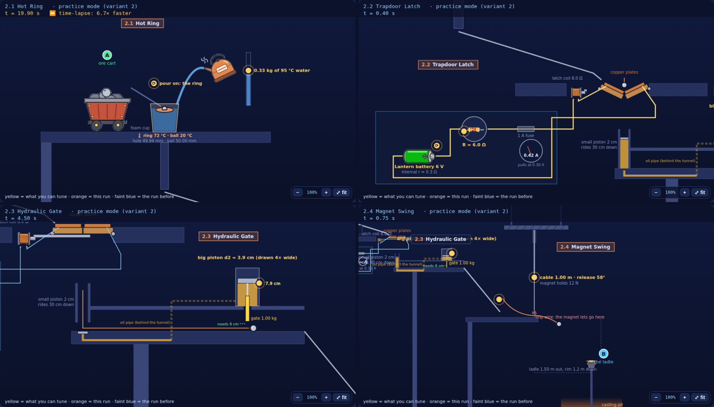
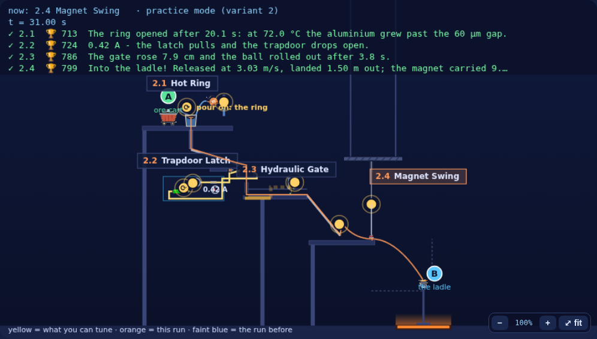

# Hall 2: The Foundry. Implementation checklist

This file tracks the progress and to-dos for the second hall of *The Machine Works*, as specified in
[`GDD-machine-works.md`](GDD-machine-works.md) §6.2. It follows the same rules as Hall 1
([`IMPLEMENTATION-hall1.md`](IMPLEMENTATION-hall1.md)), including everything from the Hall 1 playtest (round 2):
follow camera, share box, hall progression, scores and highscores.

Legend: ✅ done · 🟡 partly done · ⬜ to do · ⏸ deferred to a later stage (by decision)

| | |
|---|---|
| Status | **Hall 2 is playable end to end.** All 4 stations, the whole machine A → B, stars, points, scores, hints and practice mode work. It opens for a player once every station of Hall 1 works; in practice mode it is always open. The lab extensions it depends on (X4 thermal expansion, X6 dead-weight pressure) are shipped. |
| Tests | `python3 -m unittest discover -s tests` runs **391 tests, all green** (338 after Hall 1 round 2). The 53 new tests are in `test_foundry` (44), `test_game_api` (+3) and `test_game_browser` (+6, one for the layout below). `test_client` and `test_game` were extended. |
| Try it | `python3 -m physlab.server 8600`, then <http://127.0.0.1:8600/#/game/foundry?practice=1> (practice), or play Hall 1 to open it. |
| Tester links | [`hall2-solutions.md`](hall2-solutions.md) has the correct, mastery and top-score settings, plus game and lab deep links, for every station and variant. |



*2.1 the ring at 72 °C (time-lapse 6.7×) · 2.2 the latch has pulled, the trapdoor leaves fall away · 2.3 the gate is up 7.9 cm, the
ball rolls under it · 2.4 the magnet let go at the trip wire.*

| # | Request (same rules as Hall 1) | Status | Where |
|---|---|---|---|
| 1 | Check the assets and sprites needed for this level; complete the missing ones in the same design language | ✅ | [§1](#1-assets-and-sprites) |
| 2 | Make every knob (adjusted object) testable, so problems show up in the testing phase | ✅ | [§2](#2-knob-testability) |
| 3 | Save the correct parameters for each station; deep-link each to its working simulation | ✅ | [§3](#3-correct-settings-and-deep-links) |
| 4 | Sound, UI menus and animation outside the simulation: deferred | ⏸ | [§7](#7-deferred-to-a-later-stage) |
| 5 | A checklist document that tracks progress and to-dos | ✅ | this file |

### Layout adjustment (after the Hall 2 review, game pages only)

| Feedback | Status | What changed |
|---|---|---|
| The ▶ run / ↺ reset buttons under the canvas aren't useful on the game page: remove them | ✅ | The game page has no play bar any more. A run plays as soon as it arrives; to watch it again, run it again. Under the stage there are only **Speed** (½× 1× 2×) and **Camera** (station / follow / whole hall). |
| Move the settings and the Test station / Run machine buttons under the canvas, so they are easier to reach | ✅ | A **settings dock** sits right under the stage: the station's knobs on the left (two per row on a wide screen), the prediction and two big buttons, **▶ Test station** and **▶▶ Run machine**, on the right. On narrow screens it stacks. The left panel keeps what you read: the station list, the card, hints and scores. The HUD now says "set the yellow handles (or the settings below)". |
| Only for the game pages | ✅ | The experiment and sandbox pages keep their play bar and layout (the shared `PL.ui.PlayBar` is unchanged). |

- Code: `www/js/game.js › build` (the dock, `data-testid="game-dock"`), `www/style.css` (`.gdock`, `.gactions`).
- Test: `test_game_browser › test_the_settings_and_run_buttons_sit_under_the_stage` checks that the dock is under the stage and
  holds every knob and both buttons, that no knob is left in the side panel, that there's no play bar on the game page
  (but still one on an experiment page), that the speed control works and that a run plays by itself.
  Every other browser test still passes through the moved controls (same `data-knob` / `data-testid` selectors).

---

## 1. Assets and sprites

Same design language as Hall 1: 128 px items, flat fills, a dark outline `(34, 34, 40)`, drawn 4× and downsampled on white
(keyed out at load). Everything whose look **carries physics** is drawn in code from the run's frames or the current knobs,
so it changes with the numbers. Every new sprite is procedural: `python3 tools/make_sprites.py`.

| Asset | Station | Existed? | Action | File / code |
|---|---|---|---|---|
| Steel ball | all | ✅ catalog colour (`#c0c8d8`, 0.51 kg, 5 cm) | drawn in code; it **glows** when it's the part being heated | `scene_game.js › ball`, `hall_foundry.js › hotRingFront` |
| Ore cart (point **A**) | 2.1 | ⬜ | ✅ **new sprite** | `www/sprites/item_minecart.png` |
| Aluminium ring | 2.1 | — | ✅ code; its colour follows **its temperature** from the run (grey → orange); the front half is drawn over the ball | `hall_foundry.js › hotRing` |
| Foam cup, hot water level | 2.1 | — | ✅ code; the level follows the amount of water and the target | `hotRing` |
| Kettle | 2.1 | ⬜ | ✅ **new sprite**; tilts while pouring, the stream's width follows the water, it aims at the ring / the ball | `www/sprites/item_kettle.png` |
| Water gauge (the `water` handle), thermometer readout | 2.1 | — | ✅ code; the thermometer shows **only what a run measured** | `hotRing` |
| Drop tube, ramp | 2.1 → 2.2 | — | ✅ code | `hotRing`, `trapdoor` |
| Trapdoor: two leaves, copper plates, hinges | 2.2 | — | ✅ code; the leaves swing open by the run's `door` | `trapdoor` |
| Latch coil | 2.2 | ⬜ | ✅ **new sprite**; its steel bolt slides back when the latch pulls | `www/sprites/item_coil.png` |
| Battery | 2.2 | ✅ circuit-lab sprite | reused; click it to swap batteries | `item_battery.png` |
| Resistor dial | 2.2 | ✅ circuit-lab resistor sprite | reused + a dial drawn in code (the `R` handle) | `item_resistor.png`, `trapdoor` |
| Fuse, ammeter, wires | 2.2 | — | ✅ code; wires glow when current flows, the fuse breaks when it blows, the ammeter reads the run's current | `trapdoor` |
| Small cylinder (the ball's shaft), oil, small piston | 2.3 | piston style from the pressure scene | ✅ code; the piston follows the run's `x1` | `hydraulic` |
| Big cylinder, through-rod, gate, "needs 6 cm" mark | 2.3 | — | ✅ code; drawn 4× wide so a 2 cm piston is visible; its width is the `d2` knob; it rises by the run's `x2` | `hydraulic` |
| Oil pipe | 2.3 | — | ✅ code, dashed where it runs behind the tunnel | `hydraulic` |
| Crane girder, telescopic arm, cable | 2.4 | — | ✅ code; the cable follows the run's angle `th` | `swing`, `swingFront` |
| Crane electromagnet | 2.4 | ⬜ | ✅ **new sprite**, rotated with the cable | `www/sprites/item_magnet.png` |
| Trip wire, dashed swing arc | 2.4 | — | ✅ code | `swing` |
| Ladle (point **B**) | 2.4 | ⬜ | ✅ **new sprite**, drawn over the ball so it drops *in* | `www/sprites/item_ladle.png` |
| Casting pit glow | 2.4 | — | ✅ code | `building` |
| Hall card on the map | hub | — | ✅ the ladle sprite (the Mill's card shows Gizmo for now) | `game.js › SPRITE` |
| A / B markers, station tags, yellow handles | all | ✅ Hall 1 | reused from the shared kit | `scene_game.js › PL.gameKit` |

- ✅ The 5 new sprite names are in `PL.SPRITES` (`widgets.js`). A missing sprite still falls back to a plain box.
- ✅ `make_sprites.py` re-creates the old sprites byte-identically.
- ⬜ Art review by a designer (the same open item as Hall 1).



## 2. Knob testability

The same four levels as Hall 1: physics (unit), API, client (Node) and browser (e2e).

| Level | What is checked for Hall 2 | Where |
|---|---|---|
| **Physics (unit)** | Station table complete; **every knob has a yellow handle, and every handle is a real knob** (parsed from `hall_foundry.js`); validation refusals and snapping; each knob's effect (matrix below); **the textbook law behind each station** (ΔL = αLΔT and heat balance, Ohm's law in one loop, Pascal + incompressible oil, T = mg(3 − 2cos θ) and the flight); defaults are never an answer; references pass; wrong answers fail with the expected reason; determinism; the time-lapse zones | `tests/test_foundry.py` (44 tests) |
| | Saved settings for every variant (working, mastery, top score), thresholds mean what they say, the file is up to date (`--check`) | `TestSavedSolutions` |
| | **Every lab link reproduces the station:** same peak temperature (heat), same current (circuits), same lift and ride time (pressure), same tension and speed at the bottom (pendulum) | `TestLabLinks` |
| **API** | the Foundry is `403` for a player until Hall 1 is cleared (practice is open); a whole Foundry playthrough for a player (their variant's facts, station locks, stars, scores, `hall_cleared_new` → Mill, Golden Run, time-lapse zones in the response); practice runs for every station; validation | `tests/test_game_api.py` |
| **Client (Node)** | knob snapping for **every Foundry knob**; every saved game link (working, mastery, top score) round-trips; `PL.game.timelapse` and `PL.game.fieldAt` against a real machine run's frames | `tests/js/test_game.js` via `tests/test_client.py` |
| **Browser (e2e)** | all 12 saved links (4 stations × working / mastery / top score) pass through the UI, with mastery and the exact top score; wrong settings fail with the reason; **every handle moves its knob** (drag the gauge, click the target, click the battery, turn the dial, drag the piston, drag the pivot, drag the ball round); the machine runs A → B and the heating plays as a time-lapse; all four lab links open; the map opens the Foundry once Hall 1 is cleared | `tests/test_game_browser.py › test_foundry_*` |

**Knob matrix** (nominal variant; the windows come from [`hall2-solutions.md`](hall2-solutions.md)):

| Station · knob | Kind, range, step | Stage handle | UI selector | Effect checked | Works for (nominal) |
|---|---|---|---|---|---|
| 2.1 `target` | choice: ring / ball / both | click the ⟳ "pour on" tag (ring → ball → both) | `[data-knob="2.1.target"][data-id=…]` | ring: the hole grows · ball: it gets *tighter* (60 → 100 µm) · both: only the difference grows (needs 128 °C) | ring only |
| 2.1 `water` | number 0–0.50 kg, 0.01 | drag the gauge by the kettle | `[data-knob="2.1.water"]` | more water → hotter ring and an earlier drop | ring 0.16–0.50 kg |
| 2.2 `battery` | choice: aa / lantern / nine_v / car_battery | click the battery | `[data-knob="2.2.battery"][data-id=…]` | more volts → more current (real internal resistances) | AA never |
| 2.2 `R` | number 0–50 Ω, 0.5 | turn the dial | `[data-knob="2.2.R"]` | more R → less current, `I = V/(R + r + R_coil + 0.11)` | 6 V 0–11.5 Ω · 9 V 0–20 Ω · 12 V 4–31.5 Ω |
| 2.3 `d2` | number 2.0–10.0 cm, 0.1 | drag the big piston's right edge | `[data-knob="2.3.d2"]` | wider → more force (`A2/A1`), less lift (`30 cm × A1/A2`), a faster ride | 3.4–4.4 cm |
| 2.4 `length` | number 0.40–2.00 m, 0.05 | drag the cable's pivot up/down | `[data-knob="2.4.length"]` | longer → faster at the bottom, the same pull | see the angle |
| 2.4 `angle` | number 10–90°, 1 | drag the ball round the pivot | `[data-knob="2.4.angle"]` | bigger → faster and a harder pull, `T = mg(3 − 2cos θ)` | 1.0 m: 55–61° · 1.5 m: 45–49° · 2.0 m: 39–42° |

## 3. Correct settings and deep links

- **Generated, not hand-written:** `python3 tools/make_game_solutions.py foundry` searches every knob grid with the
  stations' own physics, for all 5 variants, and writes
  - [`physlab/game/data/foundry.json`](../../physlab/game/data/foundry.json) (the Blueprint hints and the score references
    read it), and
  - [`hall2-solutions.md`](hall2-solutions.md) (for testers: every variant, its window, working / mastery / top-score
    settings, and the links).
- `python3 tools/make_game_solutions.py --check` (all halls, run by `test_game`) fails when either file is out of date.
- **Game links** open the station in practice mode, with the variant and the settings preloaded: press **▶ Test station**.
  **Lab links** open the related experiment with the same numbers (the debrief's "🔬 Open in the lab" uses the same
  routes, for any setting, and offers the way back).

**Nominal variant** (start the server on port 8600 first):

| Station | Correct setting | Result | Game | Lab (same numbers) | Also |
|---|---|---|---|---|---|
| 2.1 Hot Ring | ring, 0.33 kg | 82.0 °C (opens at 72.0 °C after 20 s) | [play](http://127.0.0.1:8600/#/game/foundry/2.1?practice=1&v=2&k=%7B%22target%22%3A%22ring%22%2C%22water%22%3A0.33%7D) | [Heat Transfer](http://127.0.0.1:8600/#/heat?ambient=20.0&loss=0.1&mass_a=0.33&mass_b=0.3&material_a=water&material_b=aluminum&temp_a=95.0&temp_b=20.0) | [mastery 0.16 kg](http://127.0.0.1:8600/#/game/foundry/2.1?practice=1&v=2&k=%7B%22target%22%3A%22ring%22%2C%22water%22%3A0.16%7D) · [top score 0.21 kg → 1000](http://127.0.0.1:8600/#/game/foundry/2.1?practice=1&v=2&k=%7B%22target%22%3A%22ring%22%2C%22water%22%3A0.21%7D) |
| 2.2 Trapdoor Latch | lantern 6 V, R = 6 Ω | 0.416 A | [play](http://127.0.0.1:8600/#/game/foundry/2.2?practice=1&v=2&k=%7B%22R%22%3A6.0%2C%22battery%22%3A%22lantern%22%7D) | [Electric Circuits](http://127.0.0.1:8600/#/circuits?voltage=6.0&lamps=1&lamp_r=8.0&internal_r=0.41&resistor=6.0&closed=1) | [mastery 8.5 Ω](http://127.0.0.1:8600/#/game/foundry/2.2?practice=1&v=2&k=%7B%22R%22%3A8.5%2C%22battery%22%3A%22lantern%22%7D) · [top score 11.5 Ω → 1000](http://127.0.0.1:8600/#/game/foundry/2.2?practice=1&v=2&k=%7B%22R%22%3A11.5%2C%22battery%22%3A%22lantern%22%7D) |
| 2.3 Hydraulic Gate | d2 = 3.9 cm | the gate rises 7.89 cm | [play](http://127.0.0.1:8600/#/game/foundry/2.3?practice=1&v=2&k=%7B%22d2%22%3A3.9%7D) | [Pressure](http://127.0.0.1:8600/#/pressure?d1=2.0&d2=3.9&fluid=oil&force=5.0031&mass=1.1&push=weight&stroke=30.0) | [mastery 3.7 cm](http://127.0.0.1:8600/#/game/foundry/2.3?practice=1&v=2&k=%7B%22d2%22%3A3.7%7D) · [top score 4.4 cm → 1000](http://127.0.0.1:8600/#/game/foundry/2.3?practice=1&v=2&k=%7B%22d2%22%3A4.4%7D) |
| 2.4 Magnet Swing | L = 1.0 m, 58° | 9.7 N on the magnet, lands 1.50 m out | [play](http://127.0.0.1:8600/#/game/foundry/2.4?practice=1&v=2&k=%7B%22angle%22%3A58.0%2C%22length%22%3A1.0%7D) | [Pendulum](http://127.0.0.1:8600/#/pendulum?length=1.0&amplitude=58.0&mass=0.51&g=9.81&drag=0.000565) | [mastery 1.5 m, 47°](http://127.0.0.1:8600/#/game/foundry/2.4?practice=1&v=2&k=%7B%22angle%22%3A47.0%2C%22length%22%3A1.5%7D) · [top score 2.0 m, 40° → 898](http://127.0.0.1:8600/#/game/foundry/2.4?practice=1&v=2&k=%7B%22angle%22%3A40.0%2C%22length%22%3A2.0%7D) |

Whole machine, nominal: run the four correct settings with **▶▶ Run machine** (about 31 s of machine time; the 20 s of
heating play as a 3 s time-lapse).

**Where each lab link lands, and what it proves:**

| Station | Lab page | What to look at there | Checked by |
|---|---|---|---|
| 2.1 | Heat Transfer: the water is block A, the ring (or the ball, or both) is block B, with the cup's leak | Block B's top temperature = the station's result; **Block B grows** (µm per metre) and `ΔL = α·L·ΔT` | `test_2_1_the_heat_lab_reaches_the_same_temperature` |
| 2.2 | Electric Circuits: the same loop. The lamp stands in for the latch coil (same resistance); the fuse, ball and wire (0.11 Ω) are added to the battery's internal resistance | "Current (same everywhere in the loop)" = the station's current | `test_2_2_the_circuit_lab_carries_the_same_current` |
| 2.3 | Pressure with **push: a weight resting on it** (the ball's 5.0 N), the 1.1 kg gate + piston, oil, a 30 cm stroke | the big piston's rise and the time = the gate's lift and the ride | `test_2_3_the_pressure_lab_lifts_the_same` |
| 2.4 | Pendulum with the ball's mass and air drag | "String tension at the bottom" = the magnet's load; "Top speed" = the release speed | `test_2_4_the_pendulum_lab_pulls_the_same` |

## 4. Scores and stars

Every working run scores 0–1000 (a failed run 0). Each station's rule is on its card, and the debrief breaks it down.
The references are generated per variant, so **1000 is the best possible for the player's own numbers** (except 2.4, see below).

| Station | Score rule | Mastery ★★★ | What the two reward |
|---|---|---|---|
| 2.1 Hot Ring | water and waiting both cost: 40 per 10 g + 40 per second until it opens; 1000 for the cheapest way | *Waste Not*: open it with ≤ the variant's least water + 0.02 kg (0.18 kg nominal) | ★ the threshold (heat balance); 🏆 the trade-off: the cheapest is **not** the least water (0.21 vs 0.16 kg nominal) |
| 2.2 Trapdoor Latch | save the battery: 1000 for the least battery power `P = V·I` that still pulls; −40 per 0.1 W more | *Cool Coil*: coil below 1.5 W (`P = I²R`) | ★ `I²R`; 🏆 the cheapest battery and the most resistance that still works |
| 2.3 Hydraulic Gate | speed: 1000 for the fastest ride that still lifts the gate 6 cm; −20 per 0.1 s slower | *High Gate*: lift ≥ 7.5 cm | ★ a narrow piston (more lift); 🏆 a wide piston (more force, faster) - the two pull in opposite directions |
| 2.4 Magnet Swing | up to 700 for the middle of the ladle (quadratic, ±10 cm), + up to 300 for grip to spare | *Gentle Grip*: never past 9 N | both reward long cables and small angles; the best is 871–901 depending on the variant (a perfect 1000 would need zero load) |

## 5. What was built

### 5.1 Simulation module (the lab teaches first)

| GDD id | Item | Status | Files |
|---|---|---|---|
| X4 | Heat: **thermal expansion**. α per material (aluminium 23.1, iron 12, copper 16.5 × 10⁻⁶/K), a "Block X grows" readout (µm per metre at its biggest change), the formula `dL = alpha * L * dT` with its explanation, two real-life cards (bridge joints, a stuck jar lid) and the preset "Hot water on an aluminium ring" | ✅ | `physlab/topics/heat.py`, `physlab/learn.py` |
| X6 | Pressure: **`push: weight`**. A constant force (a weight resting on the piston; its mass rides down too), drawn as a steel weight; `force` from 1 N; `d2` from 2 cm; the load slider now steps by 0.1 kg (it was 10 kg, too coarse for a 1.1 kg gate); preset "A steel ball rides the piston down" | ✅ | `physlab/topics/pressure.py`, `physlab/__init__.py`, `www/js/scene_pressure.js`, `physlab/learn.py` |
| — | Presets that show each station's physics in its lab: "A latch coil on a lantern battery" (circuits), "Crane magnet: how hard does it pull?" (pendulum) | ✅ | `physlab/learn.py` |
| X5 | Circuit lab parts: fuse, relay / latch coil, ball contact | ⬜ not needed for play | 2.2 uses the circuit lab's nodal solver with plain resistors; its lab link uses Electric Circuits (see §3) |
| X7 | Pendulum: a hold force and the flight after release | ⬜ not needed for play | the hold check and the hand-off to the flight are in `foundry.py`; the lab already shows the tension at the bottom |
| — | Old fixtures unchanged (additions only) | ✅ | `tests/fixtures/heat.json`, `pressure.json` |

### 5.2 The game module

| Item | Status | Files |
|---|---|---|
| **Shared hall kit** (refactor): the generated table, variant data, thresholds, mastery/hint texts, scoring helpers, station runs and the machine run with connectors and **time-lapse zones**; Hall 1 now uses it too (its data and results are unchanged) | ✅ | `physlab/game/kit.py`, `physlab/game/bounce_factory.py` |
| Hall 2: 4 stations (data + physics adapters on `heat`, `circuitlab`, `pressure`, `pendulum` + `tracer`), the hall layout, connectors, hints with the player's numbers, Blueprints | ✅ | `physlab/game/foundry.py` |
| Registered as the second hall; the Mill stays "coming soon"; progression, locks and scores as in Hall 1 | ✅ | `physlab/game/__init__.py`, `service.py` (time-lapse zones in run responses) |
| **Scene split:** the engine (camera, trail, ball, HUD, time-lapse playback, the drawing kit `PL.gameKit`) and one painter per hall (`PL.gameHalls.<id>`: `draw`, `front`, `startPoint`, `tags`) | ✅ | `www/js/scene_game.js`, `www/js/hall_bounce.js`, `www/js/hall_foundry.js`, `www/index.html` |
| **Time-lapse playback:** slow physics comes with zones `[t0, t1, speed]`; the heating (20–40 s) plays in about 3 s, a failed heating (the 2-minute shift) in 6 s; the HUD shows "⏩ time-lapse: 6.7× faster" | ✅ | `core.js › PL.game.timelapse`, `scene_game.js › speed` |
| **Station fields along a run** (ring temperature, door, pistons, cable angle) held and interpolated across a machine run | ✅ | `core.js › PL.game.fieldAt` |
| Follow camera: with no run loaded it frames the focused station (it used to centre on the ball) | ✅ | `scene_game.js › follow` |
| Client: generic station tables (units from the data), the Foundry's hall card | ✅ | `www/js/game.js` |
| Correct-settings generator for all halls (`[hall...] [--check]`, in parallel) | ✅ | `tools/make_game_solutions.py` |

### 5.3 Decisions and deviations from the GDD

- **2.1's result (and prediction)** is the *highest* temperature of the heated part within the shift: the heat-balance
  answer, a little lower because the cup leaks (82.0 °C for 0.33 kg, the formula says 82.7 °C). The ring lets go earlier,
  at 72.0 °C; the debrief says both. The prediction label says "the part you pour on", because heating the ball is a
  legal (wrong) choice.
- **2.2 variant:** only the coil's resistance varies (7–9 Ω). The GDD also varied the pull-in current (0.28–0.32 A); one
  variant fact per station keeps the card simple, and it already moves every window.
- **2.2 trapdoor:** two leaves hinged at the outer edges, meeting under the ball (each leaf has one copper plate). A
  hinged board's free end starts down at 1.5 g, faster than the ball, so the ball falls freely. The latch pulls after
  `0.15 + 0.25·(I_pull/I)²` s: a visual delay, not scored.
- **2.3 window:** 3.4–4.4 cm at the nominal variant (the GDD said 3.3–4.4: in the final engine, 3.3 cm stalls 27.6 cm down).
  The reason text for a stall is "Stalled … cm down: the oil column's own weight pushes back as hard as the ball".
- **2.3 formula** in the debrief is `x2 = x1 · A1/A2` (distances). The lab calls the distances d1 and d2, but in the game `d2`
  is the diameter knob.
- **2.3 drawing:** the cylinders are drawn 4× wide (labelled). The big cylinder sits on the tunnel roof over the gate and
  lifts it with a through-rod; the oil pipe runs "behind the tunnel" (dashed).
- **2.4 score** is absolute (aim 700 + grip 300), like 1.4's direct shot, so its best is 871–901 depending on the variant.
- **Connectors:** 2.1 → the tube and a ramp onto the plates; 2.2 → straight down the shaft onto the small piston;
  2.3 → a chute to the pickup, then the magnet pulls the ball up to the release point.

## 6. To do (next steps for Hall 2)

- ⬜ **Classroom playtest** against the GDD §8.9 KPIs (the telemetry is in `game_runs` / `game_hints`). Watch especially:
  2.1's trap (how many heat the ball first), 2.3's stall band, 2.4's two-knob search.
- ⬜ **X5 in the lab:** fuse, latch coil and ball-contact parts in the circuit-lab sandbox, so 2.2's lab link shows the exact
  board (and Hall 3's "wooden ball on the same plates" callback has a lab page).
- ⬜ **X7 in the lab:** a magnet hold force and the flight after release in the pendulum lab.
- ⬜ **X4 "ruler" view** in the heat scene (the ring's hole in µm, growing).
- ⬜ **Quiz questions** for thermal expansion, a dead-weight hydraulic and a pendulum's pull (the quiz has three per topic
  today; adding more needs a decision on the quiz structure).
- ⬜ **Learn figures** for the new presets (heat, pressure, pendulum, circuits).
- ⬜ Review the score weights after the playtest (2.1: 40 per 10 g / 40 per s; 2.2: 40 per 0.1 W; 2.3: 20 per 0.1 s;
  2.4: 700 aim + 300 grip), and whether 2.4 should be normalised per variant.
- ⬜ Review the time-lapse speeds with students (a failed heating plays 120 s in 6 s).
- ⬜ Art review of the 5 new sprites; a layout pass for the whole-hall view (small labels are hidden below 75 px/m).
- ⬜ **Localisation:** station texts live in `foundry.py`, ready to extract.
- ✅ **Hall 3 prerequisites:** X3 (the well), X8 (optics screen), N2 (Levers & Moments) shipped with Hall 3, see
  [`IMPLEMENTATION-hall3.md`](IMPLEMENTATION-hall3.md). Since Hall 3 the game runs in **test mode** by default (every hall
  and station open); `PHYSLAB_GAME_LOCKS=on` brings back the classroom order described here.

## 7. Deferred to a later stage

By decision, none of this blocks Hall 2:

- ⏸ **Sound:** the kettle's pour, the latch's clack, the fuse's pop, the hydraulic hiss, the magnet's hum and clunk, the ladle's
  splash; captions first, audio off by default.
- ⏸ **UI menus beyond the functional hub** (animated world map, Workshop, parts shelf, settings).
- ⏸ **Animation outside the simulation:** steam and sparks (particles), Gizmo's reactions, the Golden Run cinematic,
  hub/hall transitions, star-earned effects. (The moving parts inside the simulation - the ring's colour, the door, the
  pistons, the cable - are done, because they carry physics.)

## 8. How to run and verify

```sh
python3 -m unittest discover -s tests           # everything (about 3.5 min; browser tests skip without Playwright)
python3 -m unittest tests.test_foundry          # Hall 2 stations, knobs, physics, saved settings, lab links (~15 s)
python3 -m unittest tests.test_game_api tests.test_game_browser tests.test_client
python3 tools/make_game_solutions.py foundry    # after changing a Foundry station's physics, layout or facts
python3 tools/make_game_solutions.py --check    # are the saved settings of every hall up to date?
python3 tools/make_sprites.py                   # sprites (needs Pillow)
python3 docs/game/level_math.py 2.1 2.2 2.3 2.4 # the GDD's design calculator, Hall 2 only
```

**Checklist before merging a change to a Hall 2 station:**

- ⬜ `make_game_solutions.py foundry` has been re-run, and `hall2-solutions.md` reviewed (windows not too narrow, not too wide).
- ⬜ `test_foundry` is green, including the lab-reproduces-station checks.
- ⬜ The browser e2e tests (`-k foundry`) are green.
- ⬜ If a number on a station card changed, the GDD §6.2 text is updated too.
