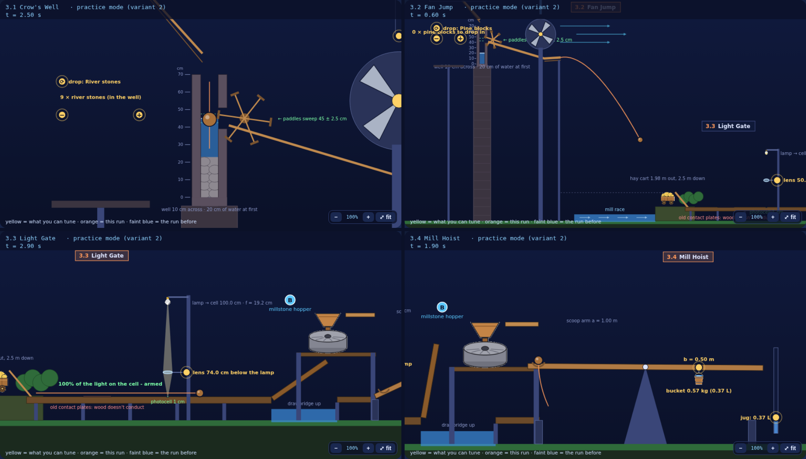
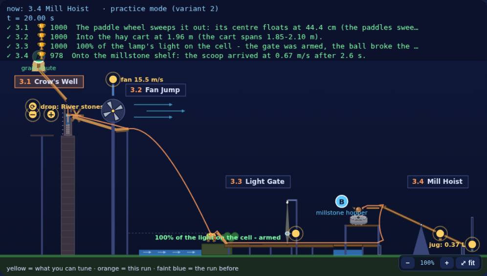

# Hall 3: Millbrook Mill. Implementation checklist

This file tracks the progress and to-dos for the third and last hall of *The Machine Works*, as specified in
[`GDD-machine-works.md`](GDD-machine-works.md) §6.3. It follows the same rules as Halls 1 and 2
([`IMPLEMENTATION-hall1.md`](IMPLEMENTATION-hall1.md), [`IMPLEMENTATION-hall2.md`](IMPLEMENTATION-hall2.md)).

Legend: ✅ done · 🟡 partly done · ⬜ to do · ⏸ deferred to a later stage (by decision)

| | |
|---|---|
| Status | **Hall 3 is playable end to end.** All 4 stations, the whole machine A → B, stars, points, scores, hints and practice mode work. The lab work it depends on is shipped: a **new topic, Levers & Moments (N2)**, and three extensions (X1 launch height, X3 the narrow well, X8 a screen behind the lens). **All three halls are built** - the map has no "coming soon" any more. |
| Test mode | **Every hall and every station is open for everyone** (the new default), so you can jump straight into the Mill. The classroom order comes back with `PHYSLAB_GAME_LOCKS=on` (see [§4](#4-test-mode-every-hall-open)). |
| Tests | `python3 -m unittest discover -s tests` runs **459 tests, all green** (391 after Hall 2). New: `test_mill` (43), `test_levers` (16: N2, X1, X3, X8), `test_game_api` (+4, the test mode), `test_game_browser` (+5). `test_api`, `test_client`, `test_quiz`, `test_learn` and `test_sandbox` cover the new topic automatically. |
| Try it | `python3 -m physlab.server 8600`, then <http://127.0.0.1:8600/#/game/mill> (as a player, straight in) or <http://127.0.0.1:8600/#/game/mill?practice=1>; the new lab topic is <http://127.0.0.1:8600/#/levers>. |
| Tester links | [`hall3-solutions.md`](hall3-solutions.md) has the correct, mastery and top-score settings, plus game and lab deep links, for every station and variant. |



*3.1 nine stones have lifted the water: the ball bobs at the paddles · 3.2 the fan's wind carries the ball over the mill
race · 3.3 the lens focuses the lamp onto the photocell, the drawbridge comes down · 3.4 just a little more water than
balance lifts the scoop gently.*

| # | Request | Status | Where |
|---|---|---|---|
| 1 | Check the assets for this level; create new ones in the same design language where needed | ✅ | [§1](#1-assets-and-sprites) |
| 2 | Make every knob and adjustable object testable | ✅ | [§2](#2-knob-testability) |
| 3 | Deep links to the working simulation | ✅ | [§3](#3-correct-settings-and-deep-links) |
| 4 | UI menus, sound and animation outside the simulation: deferred | ⏸ | [§8](#8-deferred-to-a-later-stage) |
| + | For testing: every hall usable without finishing the one before | ✅ | [§4](#4-test-mode-every-hall-open) |

---

## 1. Assets and sprites

Same design language as Halls 1 and 2 (128 px, flat fills, dark outline, drawn 4× on white and keyed out at load). What
carries physics is drawn in code from the run's frames or the current knobs. Reproducible with `python3 tools/make_sprites.py`
(the older sprites come out byte-identical).

| Asset | Used in | Existed? | Action | File / code |
|---|---|---|---|---|
| Wooden ball | all | ✅ catalog (`#a8703a`, 0.16 kg, 8 cm) | drawn in code; its density is the new lab solid *toy-ball wood* (597 kg/m³) | `scene_game.js`, `physlab/__init__.py` |
| Grain sack (point **A**) | 3.1 | ⬜ | ✅ **new sprite** | `www/sprites/item_grainsack.png` |
| Grain chute | 3.1 | — | ✅ code | `hall_mill.js › building` |
| The well (stone-lined, 10 cm), water, the paddle band, a cm ruler | 3.1 | — | ✅ code; the water level comes from the run (`lv`) | `hall_mill.js › crowsWell` |
| Stones, steel bearings, pine blocks | 3.1 | — | ✅ code, drawn at their size: a pile next to the well before the run (no preview of the answer), in the well after it (sinkers on the bottom, blocks afloat) | `crowsWell`, `item()` |
| Paddle wheel | 3.1 | — | ✅ code, turning | `crowsWell` |
| Chute and ski-jump lip | 3.2 | — | ✅ code | `hall_mill.js › fanJump` |
| Winnowing fan | 3.2 | — | ✅ code: blades spin and wind streaks flow faster with the `wind` knob | `fanJump` |
| Mill race, bank, hedge | 3.2 | — | ✅ code | `fanJump` |
| Hay cart | 3.2 | ⬜ | ✅ **new sprite** | `www/sprites/item_haycart.png` |
| Path, the old Foundry contact plates | 3.3 | — | ✅ code ("wood doesn't conduct") | `hall_mill.js › lightGate` |
| Lamp (pointing down) | 3.3 | ✅ circuit-lab lamp sprite | reused, rotated | `item_lamp.png` |
| Lens, photocell, the light cone | 3.3 | — | ✅ code; the cone and "N % of the light" appear **only after a run** | `lightGate` |
| Drawbridge over the leat | 3.3 | — | ✅ code; it comes down by the run's `bridge` | `lightGate` |
| Hoist beam, A-frame, stops, scoop | 3.4 | — | ✅ code; the beam turns by the run's `th` | `hall_mill.js › hoist` |
| Bucket | 3.4 | ⬜ | ✅ **new sprite**, sized by the water in it | `www/sprites/item_bucket.png` |
| Measuring jug (the `water` handle) | 3.4 | — | ✅ code | `hoist` |
| Millstone hopper (point **B**) + mill floor | 3.4 | ⬜ | ✅ **new sprite** (also the Mill's card on the map) | `www/sprites/item_millstone.png` |
| Levers & Moments topic icon | home, lab page | ⬜ | ✅ **new icon** in the icon set's navy-outline style | `www/icons/icon_levers.png` |
| Levers & Moments learn screenshots (3) | lab learn panel | ⬜ | ✅ captured from the app | `www/learn/levers_{1,2,3}.png` (`tools/make_figures.py --only levers`) |
| Loads on the lab's beam | levers lab | ✅ crate sprite | reused, sized by the mass | `scene_levers.js` |

- ✅ The 4 new sprite names are in `PL.SPRITES` (`widgets.js`); a missing sprite still falls back to a plain box.
- ⬜ Art review by a designer (the same open item as Halls 1 and 2).



## 2. Knob testability

The same four levels as before: physics (unit), API, client (Node) and browser (e2e).

| Level | What is checked for Hall 3 | Where |
|---|---|---|
| **Physics (unit)** | Station table complete; **every knob has a yellow handle, and every handle is a real knob** (parsed from `hall_mill.js`); validation refusals and snapping; each knob's effect (matrix below); **the textbook law behind each station**: `dh = V/A` and Archimedes (3.1), drag through the wind and "steel hardly notices" (3.2), the two sharp positions of `1/f = 1/d_o + 1/d_i` and the image size (3.3), the principle of moments and the energy of the hoist (3.4); defaults never an answer; references pass; wrong answers fail with the expected reason; determinism | `tests/test_mill.py` |
| | Saved settings for every variant (working, mastery, top score = 1000), thresholds mean what they say, the file is up to date | `TestSavedSolutions` |
| | **Every lab link reproduces the station**: the same float height (buoyancy), landing point (motion), light share and patch (optics), lift time and speed (levers) | `TestLabLinks` |
| | The new lab work: levers' balance, friction, I and the first acceleration, energy, g cancels; motion's launch height; buoyancy's well; optics' screen | `tests/test_levers.py` |
| **API** | test mode: every hall and station open for a new player, the last station of the last hall runnable directly, clearing the last hall (no next hall, Golden Run); practice runs for every station at two variants; validation (`count` must be whole, ranges, choices); hints with the variant's numbers; no answers in the public cards | `tests/test_game_api.py › TestTestingModeAPI` |
| **Client (Node)** | knob snapping for every Mill knob (the integer `count` too); every saved game link round-trips | `tests/js/test_game.js` via `tests/test_client.py` |
| **Browser (e2e)** | test mode on the map (all halls open, the banner) and a new player straight into the Mill with every station open; all 12 saved links pass through the UI (mastery and 1000 for the top setting); wrong settings fail with the reason; **every handle moves its knob** (+ / − / ⟳ by the pile, the fan gauge, the lens, the bucket's hook, the jug); the machine runs A → B; all four lab links open | `tests/test_game_browser.py › test_mill_*`, `test_test_mode_*` |

**Knob matrix** (nominal variant; the windows come from [`hall3-solutions.md`](hall3-solutions.md)):

| Station · knob | Kind, range, step | Stage handle | UI selector | Effect checked | Works for (nominal) |
|---|---|---|---|---|---|
| 3.1 `item` | choice: stone / bearing / block | click the ⟳ "drop" tag by the pile | `[data-knob="3.1.item"][data-id=…]` | sinkers push aside their whole volume, a floating block only its weight of water (half its size) | stones, bearings (blocks never) |
| 3.1 `count` | integer 0–40 | click − / + by the pile | `[data-knob="3.1.count"]` | more drops → higher water → the ball floats higher; too many overflow | stones 9–10 · bearings 26–31 |
| 3.2 `wind` | number 0–20 m/s, 0.5 | drag the gauge above the fan | `[data-knob="3.2.wind"]` | more wind → lands further (0 m/s: 1.47 m, in the race) | 14.5–16.5 m/s |
| 3.3 `d_o` | number 5–95 cm, 0.5 | drag the lens up/down the beam | `[data-knob="3.3.d_o"]` | sharp at 26 cm (5.7 cm image, 3 %) and 74 cm (0.7 cm image, 100 %); out of focus: a blur circle | 72.5–76.0 cm |
| 3.4 `hook` | number 0.20–1.00 m, 0.05 | drag the bucket's hook along the beam | `[data-knob="3.4.hook"]` | further out → less water needed (`(0.2 + w)·b = 0.26·a`) | see the water |
| 3.4 `water` | number 0–2.00 L, 0.01 | drag the measuring jug's level | `[data-knob="3.4.water"]` | more water → a faster, harder arrival; at balance it doesn't move | b = 0.3: 0.68–0.82 · 0.5: 0.33–0.42 · 0.7: 0.18–0.25 · 1.0: 0.07–0.12 L |

## 3. Correct settings and deep links

- **Generated:** `python3 tools/make_game_solutions.py mill` writes [`physlab/game/data/mill.json`](../../physlab/game/data/mill.json)
  and [`hall3-solutions.md`](hall3-solutions.md) (every variant: window, working / mastery / top-score settings, links).
  `--check` (run by `test_game`) fails when either is out of date.
- **Game links** open the station in practice mode with the variant and the settings preloaded: press **▶ Test station**.
  **Lab links** open the matching experiment with the same numbers; the debrief's "🔬 Open in the lab" links are the same
  routes for any setting.

**Nominal variant** (start the server on port 8600 first):

| Station | Correct setting | Result | Game | Lab (same numbers) | Also |
|---|---|---|---|---|---|
| 3.1 Crow's Well | 28 steel bearings | the ball's centre floats at 44.85 cm | [play](http://127.0.0.1:8600/#/game/mill/3.1?practice=1&v=2&k=%7B%22count%22%3A28%2C%22item%22%3A%22bearing%22%7D) | [Floating & Sinking: the well](http://127.0.0.1:8600/#/buoyancy?depth=20.0&extra=1832.6&fluid=water&g=9.81&material=woodball&salt=0.0&shape=sphere&size=8.0&start=23&vessel=well) | [mastery and top score: 9 stones → 1000](http://127.0.0.1:8600/#/game/mill/3.1?practice=1&v=2&k=%7B%22count%22%3A9%2C%22item%22%3A%22stone%22%7D) |
| 3.2 Fan Jump | wind 15.5 m/s | lands 1.96 m out (cart 1.85–2.10 m) | [play](http://127.0.0.1:8600/#/game/mill/3.2?practice=1&v=2&k=%7B%22wind%22%3A15.5%7D) | [Projectile Motion: from 2.5 m up](http://127.0.0.1:8600/#/motion?v0=2.0&angle=10.0&mass=0.16&drag=0.001447&wind=15.5&g=9.81&height=2.5) | [mastery 14.5 m/s](http://127.0.0.1:8600/#/game/mill/3.2?practice=1&v=2&k=%7B%22wind%22%3A14.5%7D) · top score 15.5 m/s → 1000 |
| 3.3 Light Gate | lens 74.5 cm from the lamp | 100 % of the light on the cell | [play](http://127.0.0.1:8600/#/game/mill/3.3?practice=1&v=2&k=%7B%22d_o%22%3A74.5%7D) | [Lenses: the cell as a screen](http://127.0.0.1:8600/#/optics?kind=converging&material=crown&radius=20.0&d_o=74.5&h_o=2.0&screen=25.5) | [mastery and top score: 74.0 cm → 1000](http://127.0.0.1:8600/#/game/mill/3.3?practice=1&v=2&k=%7B%22d_o%22%3A74.0%7D) |
| 3.4 Mill Hoist | hook 0.5 m, 0.37 L | arrives at 0.67 m/s | [play](http://127.0.0.1:8600/#/game/mill/3.4?practice=1&v=2&k=%7B%22hook%22%3A0.5%2C%22water%22%3A0.37%7D) | [Levers & Moments: this hoist](http://127.0.0.1:8600/#/levers?m1=0.26&d1=1.0&m2=0.57&d2=0.5&beam=1.0&friction=0.03&start=-25.0&g=9.81) | [mastery 0.34 L](http://127.0.0.1:8600/#/game/mill/3.4?practice=1&v=2&k=%7B%22hook%22%3A0.5%2C%22water%22%3A0.34%7D) · [top score 0.95 m, 0.12 L → 1000](http://127.0.0.1:8600/#/game/mill/3.4?practice=1&v=2&k=%7B%22hook%22%3A0.95%2C%22water%22%3A0.12%7D) |

Whole machine, nominal: run the four correct settings with **▶▶ Run machine** (about 18 s of machine time).

| Station | Lab page | What to look at there | Checked by |
|---|---|---|---|
| 3.1 | Floating & Sinking: **the narrow well**, 20 cm of water, the stones' volume on the bottom, the toy-ball wood ball | "Centre of the object at rest" = the station's float height; "Water level before it goes in" | `test_3_1_the_buoyancy_lab_floats_it_at_the_same_height` |
| 3.2 | Projectile Motion: **launched 2.5 m up**, the ball's mass and drag, the fan's wind | the landing point = the station's (lands at the cart's rim level) | `test_3_2_the_motion_lab_lands_it_at_the_same_place` |
| 3.3 | Lenses: the crown-glass lens, the lamp as a 2 cm candle, **a screen where the photocell is** | "Light patch on the screen", "Share on a 1 cm photocell" | `test_3_3_the_optics_lab_puts_the_same_light_on_the_cell` |
| 3.4 | **Levers & Moments**: the scoop + ball (0.26 kg) on the left, the bucket on the right, starting tilted -25° | "Time to the stop", "Left load's speed at the stop" = the scoop's arrival | `test_3_4_the_levers_lab_lifts_the_same` |

## 4. Test mode: every hall open

- **New default:** every hall and every station is open for everyone. A new player can open Millbrook Mill from the map
  and run 3.4 straight away. The map says so: "🧪 Test mode: every hall and every station is open".
- **Classroom order:** start the server with `PHYSLAB_GAME_LOCKS=on` (`1`, `true` and `yes` work too). A hall then opens
  when every station of the one before it works, and a station when the one before it works, as before. The variable is
  read on every request, so no restart is needed after a change.
- Stars, scores, "hall cleared" and Golden Runs work the same in both modes. Clearing the **last** hall celebrates the
  whole Machine Works ("that was the last hall").
- Code: `physlab/game/__init__.py › locks_on()`, `service.py › _progress / hall_view / run`, `game.js` (the banner).
  Tests: `TestGameAPI` runs with the locks on, `TestTestingModeAPI` with the default. The browser tests switch per test.

## 5. Scores and stars

| Station | Score rule | Mastery ★★★ | How they relate |
|---|---|---|---|
| 3.1 Crow's Well | aim and effort: −150 per cm off the paddles' 45 cm, −10 per thing dropped; 1000 for the best for your well | *Aesop's Crow*: the fewest drops that work (9 stones nominal) | nominally the same answer (few stones); bearings aim better but cost more drops |
| 3.2 Fan Jump | up to 700 for the middle of the cart + up to 300 for saving fan power (it grows with wind³); the best for your cart = 1000 | *Gentle Breeze*: the weakest wind that works (+1 m/s) | different: the weakest wind lands near the cart's front edge, the top score is in the middle |
| 3.3 Light Gate | focus: 1000 for the sharpest position on the slider, −40 per mm the sharp image misses the cell | *Sharp Eye*: within 0.5 cm of the sharp image | the same skill, graded finer |
| 3.4 Mill Hoist | quick AND gentle: −200 per second to the top, −500 per m/s of arrival speed; the best lift for your hoist = 1000 | *Feather Touch*: arrive at 0.5 m/s or slower | opposite pulls: the gentlest lift is slow, the best score is quicker |

## 6. What was built

### 6.1 Simulation module (the lab teaches first)

| GDD id | Item | Status | Files |
|---|---|---|---|
| N2 | **Levers & Moments** topic: a 2.2 m beam on a pivot, a load on each side (drag the hooks), the beam's mass, the pivot's friction, a start angle and ±25° stops. The engine: principle of moments, `I α = τ` with RK4, the stop crossing interpolated, energy booked (tested). Scene with turning-effect arrows and a "mass × distance" balance line; 3 formulas explained, **3 captured figures**, 6 presets, 5 real-life cards, **3 quiz questions** (easy / medium / hard), a **sandbox** (everyday loads × beams × pivots × planets), a golden fixture and a new icon | ✅ | `physlab/topics/levers.py`, `www/js/scene_levers.js`, `physlab/learn.py`, `physlab/quiz.py`, `physlab/sandbox.py`, `tests/fixtures/levers.json` |
| X1 | Motion: **launch height** (0–20 m, with the no-air formula from a height, a tower drawn, the readouts) and winds up to ±20 m/s (Beaufort up to "gale"); presets "Off a 20 m tower" and "A wooden ball in a gale" | ✅ | `physlab/topics/motion.py`, `www/js/scenes.js` |
| X3 | Buoyancy: **the narrow well** (a 10 cm stone well, 70 cm deep), the starting water depth, and stones already on the bottom (`extra`, cm³) that push the water up by V/A; a new formula `dh = V_pushed / A`, the crow-and-pitcher card, the preset "Aesop's crow"; the new solid "toy-ball wood" (597 kg/m³); objects too big for the well are shown at the biggest that fits, and an overflow is noted | ✅ | `physlab/topics/buoyancy.py`, `www/js/scene_buoyancy.js` |
| X8 | Optics: **a screen behind the lens** (`screen`, 0 = none): the light patch = the image + the blur circle `D·|s − d_i|/d_i`, the share a 1 cm photocell catches; drawn on the bench; a new formula, the light-gate card and preset | ✅ | `physlab/topics/optics.py`, `www/js/scene_optics.js` |
| — | The default runs of every older experiment are unchanged (the fixtures only gained readouts and formula entries; every frame is identical) | ✅ | `tests/gen_fixtures.py` |

### 6.2 The game module

| Item | Status | Files |
|---|---|---|
| Hall 3: 4 stations (data + physics adapters on `buoyancy`, `tracer` (= motion's drag and wind), `optics`, `levers`), the layout, connectors, hints with the player's numbers, Blueprints | ✅ | `physlab/game/mill.py` |
| Registered as the third hall; `COMING` is empty; the last hall has no next hall | ✅ | `physlab/game/__init__.py`, `service.py` |
| **Test mode / classroom locks** | ✅ | see [§4](#4-test-mode-every-hall-open) |
| Hall painter: the four stations, handles, the moving parts from the run | ✅ | `www/js/hall_mill.js` |
| A hall painter can ask for a higher label-detail threshold (the whole Mill is crowded) | ✅ | `scene_game.js › detail` |
| Integer thresholds print as integers in mastery texts ("(9)", not "(9.00)") | ✅ | `kit.py › mastery_text` |
| Correct-settings generator: solvers for 3.1–3.4 (3.1 uses the equilibrium, 3.4 walks up from balance) - all 5 variants in about 4 s | ✅ | `tools/make_game_solutions.py` |
| The home page's game card now says "Three halls: rubber, steel and wood" | ✅ | `www/js/main.js` |

### 6.3 Decisions and deviations from the GDD

- **3.1:** the paddles sweep at 45 ± 2.5 cm. Instead of the GDD's grate, "too high" means the paddles sweep *under* the
  ball, and 40 stones **overflow** the 70 cm well (a separate failure). The things to drop wait in a pile until the run, so
  the water level isn't previewed. The ball falls in from near the rim and bobs to rest (the real buoyancy engine); the
  verdict uses its resting height.
- **3.1 score vs mastery:** the score charges aim (150/cm) and effort (10 per drop), so at the nominal variant the best
  score is also the fewest drops (9 stones). Bearings aim better but need ~3× as many drops.
- **3.2:** the cart's variant is 1.90–2.05 m, nominal 1.975 m (window 14.5–16.5 m/s; the GDD said 15.0–17.0 for a
  1.98 m cart). A miss into the race floats "back down the race - no harm done", as in the GDD.
- **3.3:** the bench is vertical (the lamp hangs over the path, the photocell is in the path). The cone of light and the
  share on the cell are drawn only after a run. The bench variant is 95–105 cm.
- **3.4:** the hoist is levers.run with the scoop + ball (0.26 kg) on the left at the variant's arm, the bucket on the
  right; it starts at −25° (scoop down). The windows match the GDD exactly. The bucket hangs on a short rope so it clears
  the floor at +25°.
- **Layout:** the millstone hopper sits on a mill floor over the drawbridge's leat; a fixed deck takes the ball from the
  bridge to the scoop.

## 7. To do (next steps for Hall 3)

- ⬜ **Classroom playtest** against the GDD §8.9 KPIs, now with all three halls. Watch: 3.1 (do they try pine blocks
  first?), 3.3 (how many stop at the 26 cm trap?), 3.4 (balance first, or trial and error?).
- ⬜ **Decide the default for the locks** before the classroom: test mode is the default now; a classroom server needs
  `PHYSLAB_GAME_LOCKS=on` (or flip the default in `locks_on()`).
- ⬜ **The Hall 1 → 3 callback** of GDD §6.3: 3.3's contact plates are the *Foundry's* plates. A ghost of the steel ball
  closing them (material ghosts, GDD §4.5) would make the point visually.
- ⬜ Levers lab: a **compare mode** (two beams side by side) and a draggable start angle.
- ⬜ Buoyancy sandbox: the well as a container choice (the lab has it; the sandbox still only has the tank).
- ⬜ Learn figures for the new presets (motion from a height, the well, the photocell screen).
- ⬜ Review the score weights after the playtest (3.1: 150/cm + 10/drop; 3.2: 700 aim + 300 power; 3.3: 40/mm; 3.4:
  200/s + 500 per m/s).
- ⬜ Art review of the 4 new sprites and the icon; a layout pass for the whole-hall view (it's the most crowded hall).
- ⬜ Badges and ball skins (GDD §7.5–7.6), and the "after the three halls" content (GDD §3.5).
- ⬜ **Localisation:** station texts live in `mill.py`, ready to extract.

## 8. Deferred to a later stage

By decision, none of this blocks Hall 3:

- ⏸ **Sound:** the splash in the well, the fan's whoosh, the bridge's clank, the hoist's creak, the millstones' rumble.
- ⏸ **UI menus beyond the functional hub** (animated world map, Workshop, parts shelf, settings).
- ⏸ **Animation outside the simulation:** ripples and droplets, chaff blown by the fan, Gizmo, the Golden Run and
  "last hall cleared" cinematics, transitions. (What carries physics moves: the water, the fan, the bridge, the beam.)

## 9. How to run and verify

```sh
python3 -m unittest discover -s tests           # everything (about 5 min; browser tests skip without Playwright)
python3 -m unittest tests.test_mill tests.test_levers
python3 -m unittest tests.test_game_api tests.test_game_browser tests.test_client
PHYSLAB_GAME_LOCKS=on python3 -m physlab.server 8600   # the classroom order (halls and stations open in turn)
python3 tools/make_game_solutions.py mill       # after changing a Mill station's physics, layout or facts
python3 tools/make_game_solutions.py --check    # are the saved settings of every hall up to date?
python3 tools/make_sprites.py                   # sprites + icons (needs Pillow)
python3 tools/make_figures.py --only levers     # the Levers & Moments learn screenshots (Playwright)
python3 docs/game/level_math.py 3.1 3.2 3.3 3.4 # the GDD's design calculator, Hall 3 only
```

**Checklist before merging a change to a Hall 3 station:**

- ⬜ `make_game_solutions.py mill` has been re-run, and `hall3-solutions.md` reviewed.
- ⬜ `test_mill` and `test_levers` are green, including the lab-reproduces-station checks.
- ⬜ The browser e2e tests (`-k mill`) are green.
- ⬜ If a number on a station card changed, the GDD §6.3 text is updated too.
